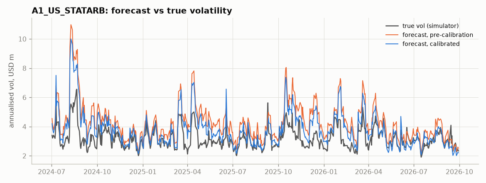
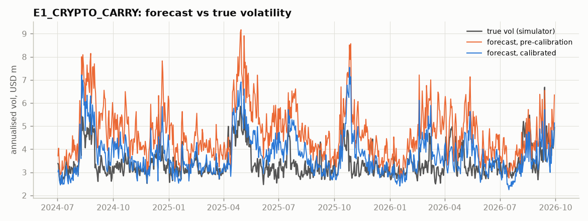

# Risk-model calibration against the true covariance

> **Question answered:** how far are the risk forecasts from the true risk, which layer of the risk model causes the gap, and which settings close it?  Synthetic data only: the simulator's true conditional covariance is rebuilt and compared with the forecast for every test portfolio, every day.

## 1. Method

* **Truth.** The generator is re-run with its seed (bit-for-bit identical to `data/`), keeping the true exposures. Each day's true covariance is A Ω Aᵀ + D: GJR-GARCH market variance, the regime as a mixture over yesterday's regime, macro-day scalings, the ×3 ETF-flow vol on rebalance days, BTC variance over the calendar gap, and the coupled block (market, reversal, liquidity, crowding, vol shock, liquidity shock) integrated by Monte Carlo from the simulator's equations. Stress shocks are surprises, not variance.
* **Test portfolios.** The six strategy books; 10 random dollar-neutral portfolios per market; the cap-weighted market; and portfolios *optimised with the model being tested* (minimum variance and mean-variance optimal for 5 random alphas, every 5th day). Hedged books expose over-forecasts and optimised portfolios expose under-forecasts, so a setting cannot win by moving the level alone.
* **Scores.** *Forecast / true* is the geometric mean of predicted ÷ true vol (1 = unbiased). *Truth error* is the RMS of log(predicted ÷ true vol): bias and timing together. Groups are weighted equally. *Fit* is the first half of the period (used to choose settings) and *test* is the second half. *Realised Q* = mean(z² − ln z²) with z = realised ÷ forecast: lower is better. It is the only yardstick available on real data, and it is noisy.

Truth check: std(realised ÷ true vol) should be about 1 for every portfolio type (China slightly lower because price limits clip returns):

| market | strategy | random long/short | cap-weighted long | optimised: min variance | optimised: random alpha |
|---|---|---|---|---|---|
| CN | 0.974 | 0.917 | 1.047 | 1.047 | 0.963 |
| CRYPTO | 0.962 | 0.989 | 1.080 | 1.092 | 1.086 |
| US | 1.089 | 1.013 | 1.030 | 0.895 | 0.962 |

## 2. Pre-calibration vs current settings

| config | truth error (fit) | truth error (test) | |log bias| | realised Q | f/t strategy | f/t random long/short | f/t cap-weighted long | f/t optimised: min variance | f/t optimised: random alpha |
|---|---|---|---|---|---|---|---|---|---|
| pre-calibration | 0.209 | 0.195 | 0.101 | 2.493 | 1.264 | 1.079 | 0.943 | 1.003 | 0.890 |
| current | 0.174 | 0.166 | 0.060 | 2.470 | 1.127 | 1.025 | 0.971 | 1.057 | 0.951 |

Current settings that differ from pre-calibration: `{'lw_max': 0.4, 'macro_mult_cap': 6.0, 'macro_per_factor': True, 'denoise_factor_cov': True, 'specific_leverage_adj': True}`

### Strategy books

| strategy | forecast / true, pre | forecast / true, now | factor part, pre | factor part, now | realised bias, pre | realised bias, now | bias if forecast = truth |
|---|---|---|---|---|---|---|---|
| A2_CN_STATARB | 1.182 | 1.082 | 1.387 | 1.197 | 0.834 | 0.907 | 0.974 |
| E1_CRYPTO_CARRY | 1.363 | 1.082 | 2.583 | 1.453 | 0.725 | 0.906 | 0.962 |
| A1_US_STATARB | 1.320 | 1.167 | 1.382 | 1.178 | 0.809 | 0.921 | 1.068 |
| B1_US_INTRADAY | 1.315 | 1.223 | 1.443 | 1.281 | 0.837 | 0.898 | 1.074 |
| D1_US_CROWDING | 1.271 | 1.134 | 1.316 | 1.136 | 0.851 | 0.954 | 1.062 |
| C1_US_EVENT | 1.150 | 1.080 | 1.249 | 1.079 | 0.934 | 0.991 | 1.075 |

*Factor part* compares the model's factor variance with the true factor variance. The two use different factor sets (the hidden theme sits in the statistical factors, for example), so read it as a direction, not an exact split.

## 3. What each layer contributes (ablation of the current settings)

| config | truth error (fit) | truth error (test) | |log bias| | realised Q | f/t strategy | f/t random long/short | f/t cap-weighted long | f/t optimised: min variance | f/t optimised: random alpha |
|---|---|---|---|---|---|---|---|---|---|
| current | 0.174 | 0.166 | 0.060 | 2.470 | 1.127 | 1.025 | 0.971 | 1.057 | 0.951 |
| no eigen adjustment | 0.184 | 0.183 | 0.087 | 2.498 | 1.050 | 1.005 | 1.072 | 1.245 | 0.949 |
| no Ledoit-Wolf shrinkage | 0.172 | 0.168 | 0.065 | 2.492 | 1.115 | 1.018 | 0.987 | 1.093 | 0.948 |
| no factor VRA | 0.190 | 0.178 | 0.082 | 2.477 | 1.176 | 1.040 | 1.020 | 1.111 | 0.953 |
| no specific VRA | 0.168 | 0.161 | 0.062 | 2.482 | 1.131 | 1.033 | 0.973 | 1.062 | 0.956 |
| no macro-day uplift | 0.176 | 0.169 | 0.058 | 2.476 | 1.120 | 1.022 | 0.958 | 1.038 | 0.951 |
| no event-day specific uplift | 0.181 | 0.167 | 0.060 | 2.479 | 1.133 | 1.018 | 0.983 | 1.073 | 0.955 |
| no factor de-noising | 0.208 | 0.188 | 0.094 | 2.488 | 1.293 | 1.106 | 0.948 | 0.997 | 0.966 |
| no specific leverage adjustment | 0.185 | 0.181 | 0.077 | 2.479 | 1.145 | 1.026 | 0.961 | 1.044 | 0.885 |
| raw EWMA (all off) | 0.200 | 0.190 | 0.104 | 2.502 | 1.143 | 1.027 | 1.060 | 1.156 | 0.872 |

## 4. The two suspected causes

### Ledoit-Wolf shrinkage of factor correlations

| config | truth error (fit) | truth error (test) | |log bias| | realised Q | f/t strategy | f/t random long/short | f/t cap-weighted long | f/t optimised: min variance | f/t optimised: random alpha |
|---|---|---|---|---|---|---|---|---|---|
| lw_max = 0.0 | 0.172 | 0.168 | 0.065 | 2.492 | 1.115 | 1.018 | 0.987 | 1.093 | 0.948 |
| lw_max = 0.1 | 0.174 | 0.168 | 0.064 | 2.484 | 1.118 | 1.020 | 0.981 | 1.092 | 0.949 |
| lw_max = 0.25 | 0.174 | 0.167 | 0.063 | 2.478 | 1.123 | 1.022 | 0.974 | 1.078 | 0.951 |
| lw_max = 0.4 | 0.174 | 0.166 | 0.060 | 2.470 | 1.127 | 1.025 | 0.971 | 1.057 | 0.951 |
| lw_max = 0.6 | 0.175 | 0.166 | 0.060 | 2.471 | 1.129 | 1.026 | 0.970 | 1.051 | 0.951 |
| lw_max = 1.0 | 0.176 | 0.166 | 0.060 | 2.470 | 1.129 | 1.027 | 0.970 | 1.049 | 0.951 |

### Macro-day uplift

| config | truth error (fit) | truth error (test) | |log bias| | realised Q | f/t strategy | f/t random long/short | f/t cap-weighted long | f/t optimised: min variance | f/t optimised: random alpha |
|---|---|---|---|---|---|---|---|---|---|
| no uplift | 0.176 | 0.169 | 0.058 | 2.476 | 1.120 | 1.022 | 0.958 | 1.038 | 0.951 |
| one uplift (market's) for all, cap 3 | 0.174 | 0.166 | 0.060 | 2.472 | 1.122 | 1.022 | 0.974 | 1.062 | 0.951 |
| per factor, cap 3 | 0.174 | 0.166 | 0.060 | 2.470 | 1.124 | 1.024 | 0.971 | 1.057 | 0.951 |
| per factor, cap 6 | 0.174 | 0.166 | 0.060 | 2.470 | 1.127 | 1.025 | 0.971 | 1.057 | 0.951 |

Estimated macro-day variance ratios (end of sample, before the cap) against the simulator's scalings:

| market | factor | macro days | estimated ratio | applied (shrunk) | simulated truth |
|---|---|---|---|---|---|
| US | market | 78.000 | 1.887 | 1.786 | 1.960 |
| US | vol_shock | 78.000 | 1.996 | 1.883 | – |
| US | fx | 78.000 | 4.236 | 3.868 | 4.000 |
| US | rates | 78.000 | 6.574 | 5.940 | 6.250 |
| CN | market | 90.000 | 1.027 | 1.024 | 1.960 |
| CN | vol_shock | 90.000 | 1.178 | 1.160 | – |
| CN | fx | 90.000 | 3.145 | 2.930 | 2.250 |
| CN | rates | 90.000 | 4.013 | 3.712 | 4.000 |

## 5. Factor-return sampling noise and specific-risk leverage

Each day's factor returns come from a regression on 300 (US), 160 (CN) or 40 (crypto) names, so they carry sampling noise Q e, where Q is the regression projection and e the specific returns. A covariance estimated from those returns counts Q D Qᵀ as factor risk, although it is specific risk that the book already pays for in its specific term. A factor-tilted book cannot diversify it away, so its risk is over-forecast. The same regression pulls each name's fit toward its own return, so residuals understate specific variance by about the leverage K/N. `denoise_factor_cov` subtracts the EWMA of Q D Qᵀ from the factor covariance. `specific_leverage_adj` divides squared residuals by their expected shrinkage κᵢ = Σⱼ Mᵢⱼ² dⱼ / dᵢ, with M = I − X Q. The validation report's factor bias statistic adds the noise back, because it tests F against the *estimated* factor returns.

## 6. Not closed by these settings

* The US stat-arb and intraday books stay over-forecast. Their model exposures to reversal, overnight gap and the time-series shocks exceed their true exposures, because exposures are estimated with error (time-series betas, descriptor definitions). Exposure noise adds to forecast risk in the same way factor-return noise does, but needs a model of the exposure error before it can be removed.
* Optimised portfolios' *factor* risk is under-forecast: the optimiser finds the directions the model misses (the hidden theme, crypto linkage). Their total is close to the truth only because specific risk is slightly high.
* The settings are tuned on one simulated history. On real data only the realised Q-statistic and bias statistics are available, and their direction agrees with the truth score here.