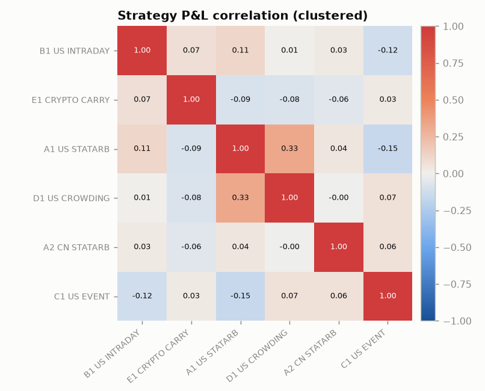
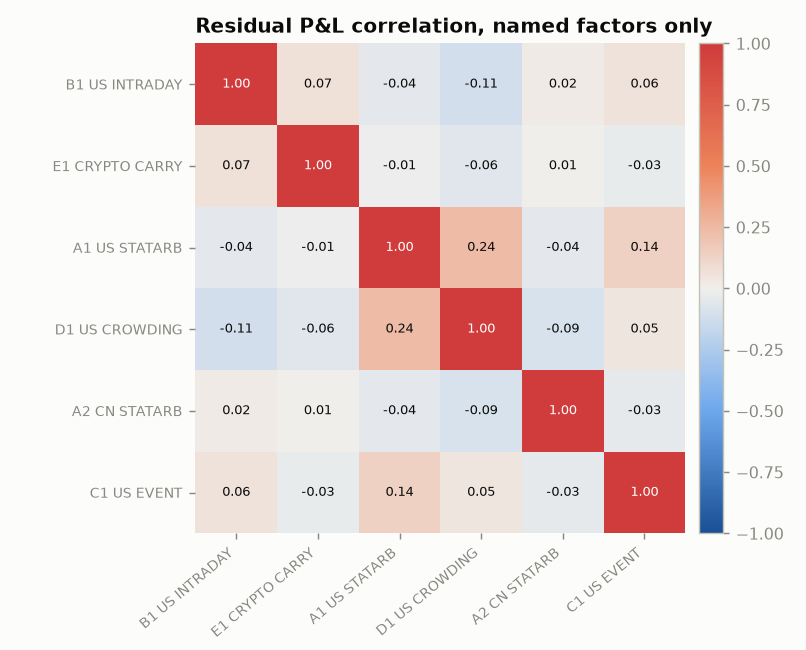

# Management summary - as of 2026-09-30

> **Decisions supported:** capital and risk budgets per team, strategy shutdowns, firm risk appetite.

## Key findings

- **A2_CN_STATARB**: linear and SHAP attribution disagree on crowding (daily corr +0.09; linear -0.15m, SHAP -0.85m).
- **A1_US_STATARB** selects on characteristics outside the core model: theme_tag (XGBoost surrogate out-of-sample R² 0.23; mean |SHAP|).
- **D1_US_CROWDING** selects on characteristics outside the core model: theme_tag (XGBoost surrogate out-of-sample R² 0.61; mean |SHAP|).
- US named-model residuals have 7 eigenvalue(s) above the Marchenko-Pastur edge; PC1 is most associated with **theme:AI infrastructure** (corr -0.58). Recommendation: promote it to an explicit core factor through governance.
- Residual P&L of **A1_US_STATARB** and **D1_US_CROWDING** is correlated (+0.24 named-only, +0.18 with statistical factors): it survives the statistical factors, so it is shared idiosyncratic bets rather than a missing factor (average position cosine overlap +0.12) - the two books are partly the same alpha.
- **E1_CRYPTO_CARRY** is dollar-neutral (net -0.5%) but beta-adjusted net -7.8% of gross.
- Model release **D1_US_CROWDING v2.0** (2025-06-02) most changed `size` exposure +0.05 -> -0.14 (t=-14.7).
- Model release **A2_CN_STATARB v2.3** (2025-05-12) most changed `size` exposure +0.00 -> -0.25 (t=-6.4).
- Model release **C1_US_EVENT v1.4** (2026-01-12) most changed `beta` exposure -0.41 -> -0.18 (t=4.8).
- Model release **E1_CRYPTO_CARRY v1.6** (2025-12-01) most changed `funding` exposure -0.65 -> -0.44 (t=4.3).
- Model release **A1_US_STATARB v3.2** (2025-09-15) most changed `beta` exposure -0.07 -> +0.06 (t=3.2).
- **A1_US_STATARB** is short volatility: a 3-sigma implied-vol shock has historically cost 231k (t=-9.3), while the Gaussian risk model implies +28k - liquidity-provision losses cluster in stress, so shock limits use the worse of the two.
- **D1_US_CROWDING** is short volatility: a 3-sigma implied-vol shock has historically cost 101k (t=-4.4), consistent with the risk model.
- **B1_US_INTRADAY** looks intraday beta-neutral on concurrent 30-minute betas (-0.015 per $ gross) but carries +0.046 on lag-corrected betas (Epps effect) - hedge with Dimson betas.
- Internal crowding (US): 177 names are held on the same side by two or more teams (77% of firm gross); exiting together costs 22k more than each team exiting alone.
- Factor-level crowding (CN): `overnight_gap` comomentum z=2.5 - stress shocks on these factors are scaled up.
- Factor selection: core factors failing the tests (review for the monitoring layer) - `index_rebalance` (US), `option_expiry` (US), `corporate_action` (US), `option_expiry` (CN), `corporate_action` (CN), `in_play` (CN).
- **C1_US_EVENT** raw Sharpe 0.78 understates skill: residual Sharpe 2.66 - factor P&L -0.8m is a drag.

## Are we paying for alpha or for factor exposure?

Residual Sharpe uses only the non-factor part of holding P&L; 95% confidence intervals (Lo 2002) show how much of the difference is noise.

| strategy | team | avg_gmv | total_pnl | sharpe | sharpe_95ci | residual_sharpe | residual_95ci | net_alpha_sharpe | factor_pnl | cost_pnl |
|---|---|---|---|---|---|---|---|---|---|---|
| A1_US_STATARB | TEAM_ALPHA | 60.02m | 32.51m | 4.103 | [2.77, 5.43] | 13.892 | [12.35, 15.43] | 7.225 | 8.36m | -7.73m |
| A2_CN_STATARB | TEAM_ALPHA | 25.03m | 7.34m | 1.685 | [0.35, 3.02] | 10.626 | [9.16, 12.09] | 1.844 | 3.38m | -7.92m |
| B1_US_INTRADAY | TEAM_BRAVO | 6.01m | 12.22m | 2.969 | [1.65, 4.29] | -0.528 | [-1.84, 0.78] | 3.574 | -1.13m | -41.89m |
| C1_US_EVENT | TEAM_CHARLIE | 29.21m | 4.47m | 0.779 | [-0.53, 2.09] | 2.655 | [1.34, 3.97] | 1.317 | -0.85m | -1.00m |
| D1_US_CROWDING | TEAM_DELTA | 50.03m | 14.69m | 2.115 | [0.80, 3.43] | 6.744 | [5.38, 8.11] | 3.918 | 5.02m | -2.89m |
| E1_CRYPTO_CARRY | TEAM_ECHO | 20.03m | 20.68m | 2.020 | [0.73, 3.31] | 7.588 | [6.23, 8.94] | 1.687 | 5.04m | -33.45m |

### By team

| team | avg_gmv | total_pnl | factor_pnl | cost_pnl |
|---|---|---|---|---|
| TEAM_ALPHA | 85.05m | 39.85m | 11.74m | -15.66m |
| TEAM_BRAVO | 6.01m | 12.22m | -1.13m | -41.89m |
| TEAM_CHARLIE | 29.21m | 4.47m | -0.85m | -1.00m |
| TEAM_DELTA | 50.03m | 14.69m | 5.02m | -2.89m |
| TEAM_ECHO | 20.03m | 20.68m | 5.04m | -33.45m |

## How diversified are we really?

- Effective number of independent bets (total P&L, participation ratio): **5.6** of 6 strategies; on residual P&L: **5.9**.
- Cluster order (similar strategies adjacent): B1_US_INTRADAY → E1_CRYPTO_CARRY → A1_US_STATARB → D1_US_CROWDING → A2_CN_STATARB → C1_US_EVENT.

## Risk budget usage

| strategy | gross | pred_vol_ann_pct_gmv | factor_risk_share | beta_adj_net_pct |
|---|---|---|---|---|
| A1_US_STATARB | 59.27m | 3.8% | 66.9% | 1.5% |
| A2_CN_STATARB | 24.38m | 7.6% | 77.3% | -4.0% |
| B1_US_INTRADAY | 5.97m | 9.0% | 81.6% | -1.5% |
| C1_US_EVENT | 29.70m | 5.6% | 24.2% | -1.6% |
| D1_US_CROWDING | 49.25m | 6.5% | 86.0% | -1.4% |
| E1_CRYPTO_CARRY | 20.33m | 26.2% | 71.4% | -7.8% |

## Firm-level tail risk (hypothetical scenarios on current holdings)

| scenario | firm_pnl_usd | crowding_scaled_usd |
|---|---|---|
| Aug-2007 quant deleveraging | -4.78m | -5.08m |
| Jan-2021 short squeeze | -1.31m | -1.58m |
| Mar-2020 COVID crash | -0.47m | -0.54m |
| Aug-2024 carry unwind | -0.24m | -0.30m |
| Rates shock / hawkish surprise | -0.13m | -0.13m |
| Nov-2020 momentum/value rotation | 0.35m | 0.39m |
| Nov-2022 FTX failure | 1.07m | 1.07m |
| May-2022 LUNA collapse | 2.39m | 2.39m |
