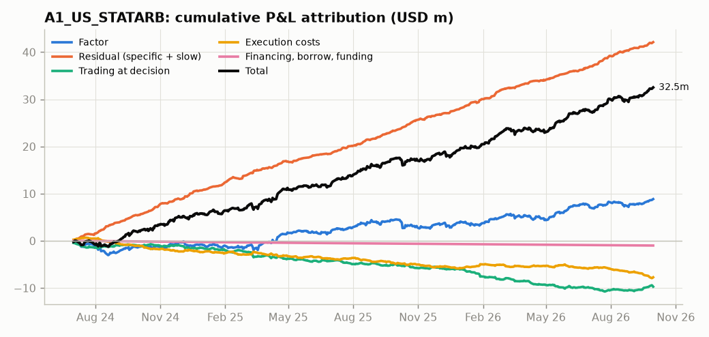
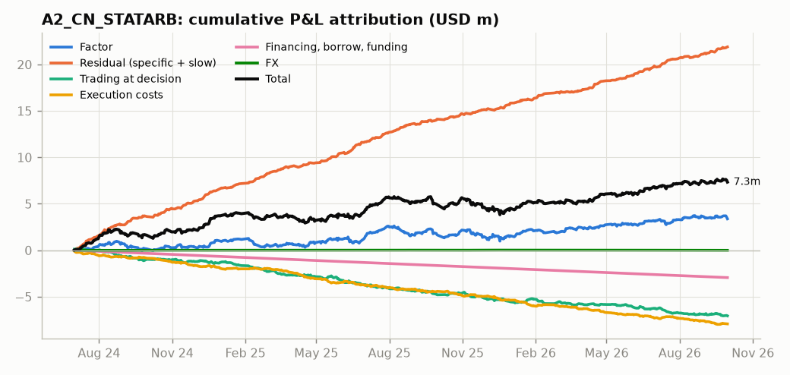
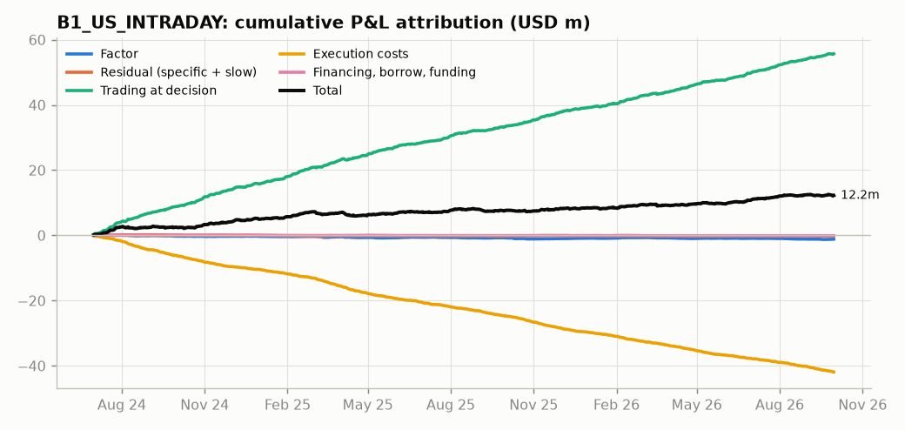
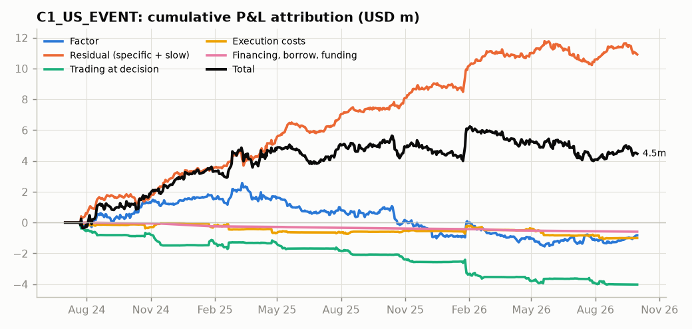
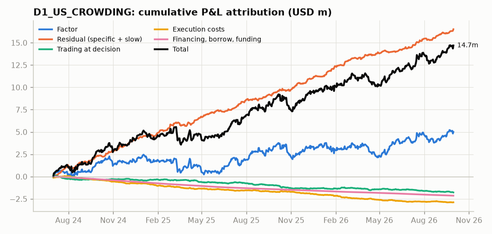
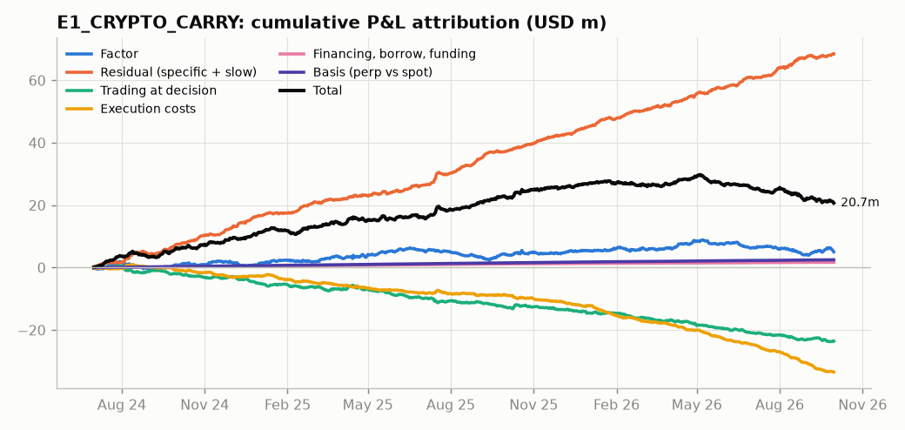

# PM attribution report - as of 2026-09-30

> **Decisions supported:** hedges and optimizer constraints, model-release approval, capacity and cost management.

Short-window attribution (20 days) is noisy - read it alongside the since-inception columns.

## A1_US_STATARB (TEAM_ALPHA)

| index | since_inception | last_20d |
|---|---|---|
| factor | 8.36m | 1.03m |
| slow_factor | 1.12m | 44,405 |
| specific | 41.50m | 1.34m |
| basis | 0 | 0 |
| fx | 0 | 0 |
| trading | -9.72m | 0.82m |
| delay_cost | 5.04m | -0.81m |
| impact_cost | -11.40m | -0.24m |
| commissions | -1.37m | -50,316 |
| financing | -0.46m | -16,390 |
| borrow | -0.54m | -20,822 |
| funding | 0 | 0 |
| TOTAL attributed | 32.51m | 2.10m |
| official | 32.54m | 2.10m |

**Largest factor P&L contributors (since inception)**

| factor | pnl_usd |
|---|---|
| st_reversal | 10.10m |
| size | -2.10m |
| crypto_beta | -1.78m |
| liquidity | 1.27m |
| ind_Health Care | -0.79m |
| ind_Semiconductors | 0.68m |
| rates | -0.58m |
| liq_shock | 0.51m |

**Execution costs:** 3.61 bps of 21.4bn traded (delay -2.35, impact 5.32, fees 0.64 bps).

**Intraday decomposition (last 60 days, 30-minute bars)**[^intraday-factors]

| overnight_futures | overnight_factor | overnight_residual | intraday_futures | intraday_factor | intraday_order_flow | intraday_residual | within_bar_trading | intraday_total | daily_mtm | reconciliation_diff |
|---|---|---|---|---|---|---|---|---|---|---|
| -8,539 | 1.04m | 1.13m | 30,817 | 1.39m | 1.93m | 1.26m | -1.42m | 5.35m | 5.35m | 0 |

Intraday vs daily reconciliation: max |diff| $0 per day. Futures = index-futures market factor (intraday beta); order flow = imbalance factor (attribution only).

**Intraday beta at peak position** (per $ gross): concurrent 30-minute -0.002, lag-corrected (Dimson) +0.015, daily +0.012. A gap between the first two is the Epps effect.

**Market-wide shock sensitivity (3-sigma, USD):** vol_shock model +32k / empirical -231k; liq_shock model -18k / empirical -214k; fx model -64k / empirical -14k; rates model -36k / empirical -53k

**Candidate / background monitor exposures** (std units per $ gross, not attributed): hf_ownership_13f -0.03

**Hedging / neutralisation candidates**

| factor | exposure_usd_per_unit | risk_contrib_pct | vol_reduction_pct | suggested_tool |
|---|---|---|---|---|
| st_reversal | 19.65m | 29.5% | 13.7% | optimizer constraint |
| liquidity | -15.13m | 7.3% | 3.9% | optimizer constraint |

**What the model is effectively selecting on** (XGBoost surrogate of position weight / GMV; R² 0.33 in sample, 0.23 out of sample on the last 30% of dates)

| feature | mean_abs_shap_bp | shap_share | perm_importance | maps_to_core_factor |
|---|---|---|---|---|
| reversal_5d | 15.566 | 34.3% | 0.558 | st_reversal |
| log_turnover | 6.277 | 13.8% | 0.065 | liquidity |
| intraday_mom_3d | 5.540 | 12.2% | 0.062 | st_momentum |
| volatility_20d | 5.345 | 11.8% | 0.063 | volatility |
| theme_tag | 3.991 | 8.8% | 0.036 | – |
| gap_5d | 2.213 | 4.9% | 0.011 | overnight_gap |
| sector | 1.562 | 3.4% | 0.000 | industry |
| log_mcap | 1.532 | 3.4% | 0.010 | size |

Grouped by core factor (SHAP summed within a group, so correlated inputs are not split): st_reversal 35%; liquidity 14%; st_momentum 12%; volatility 12%; unmapped:theme_tag 9%

Strongest interactions (mean |SHAP interaction|, bp): reversal_5d × intraday_mom_3d = 2.1; reversal_5d × gap_5d = 1.1; reversal_5d × log_turnover = 1.0

Fit by target (linear = ridge on the same features; trees adding little over linear means the selection is close to a linear screen):

| target | model | metric | in_sample | out_of_sample |
|---|---|---|---|---|
| weight | xgboost | R² | 0.325 | 0.234 |
| weight | linear | R² | 0.231 | 0.221 |
| rank | xgboost | R² | 0.321 | 0.240 |
| rank | linear | R² | 0.231 | 0.224 |
| held_only | xgboost | R² | 0.364 | 0.261 |
| held_only | linear | R² | 0.271 | 0.252 |
| held | xgboost | AUC | 0.797 | 0.588 |

**SHAP cross-check of the linear attribution** (return surrogate: per-date additive XGBoost, cross-fitted R² 0.097 vs 0.098 for a cross-fitted linear model on the same features and 0.308 in-sample for the factor model). Both columns add up to the same holdings P&L. The cross-fitted surrogate cannot absorb a stock's own return, so its characteristic buckets are smaller and its residual larger: read agreement from the daily correlation and sign, not the size of the totals.

| bucket | linear_usd | shap_usd | diff_usd | daily_corr |
|---|---|---|---|---|
| base | 70,875 | -0.13m | -0.20m | 0.451 |
| industry | 41,864 | 1.51m | 1.47m | 0.681 |
| st_reversal | 10.10m | 2.02m | -8.08m | 0.658 |
| volatility | 63,669 | -1.26m | -1.32m | 0.701 |
| liquidity | 1.27m | 1.05m | -0.23m | 0.720 |
| size | -2.10m | -0.30m | 1.80m | 0.645 |
| crowding | 0.10m | -0.10m | -0.21m | 0.689 |
| beta | -0.10m | -4,384 | 97,505 | 0.721 |
| earnings | 0.41m | -40,262 | -0.45m | 0.227 |
| in_play | -11,423 | 0 | 11,423 | – |
| overnight_gap | -0.35m | 1.28m | 1.63m | 0.514 |
| st_momentum | 0.24m | 0.37m | 0.13m | 0.502 |
| etf_ownership | -0.39m | -0.11m | 0.27m | 0.612 |
| retail_attention | -0.30m | 0.11m | 0.41m | -0.075 |
| unmapped:theme_tag | 0 | -0.36m | -0.36m | – |
| other (linear only) | -0.69m | 0 | 0.69m | – |
| slow (linear only) | 1.12m | 0 | -1.12m | – |
| residual | 41.50m | 46.70m | 5.21m | 0.647 |
| outside_estu | 0 | 0.24m | 0.24m | – |
| total | 50.97m | 50.97m | 0 | 1.000 |

Decision view (weight-side SHAP: P&L of the slice of the book each characteristic explains; unexplained weights +43.72m): st_reversal +9.00m; st_momentum -1.21m; unmapped:theme_tag +0.93m; liquidity -0.63m; industry -0.60m.

**Model release comparison (20 days before vs after)**

| version | release_date | factor | before | after | t_stat | material |
|---|---|---|---|---|---|---|
| v3.2 | 2025-09-15 | beta | -0.070 | 0.064 | 3.248 | yes |
| v3.2 | 2025-09-15 | beta_adj_net | -0.014 | 0.016 | 3.434 | yes |
| v3.2 | 2025-09-15 | crowding | 0.091 | 0.117 | 0.822 | no |
| v3.2 | 2025-09-15 | fx | -0.082 | 0.002 | 4.018 | yes |
| v3.2 | 2025-09-15 | liq_shock | -0.002 | -0.001 | 3.049 | yes |
| v3.2 | 2025-09-15 | liquidity | -0.184 | -0.182 | 0.083 | no |
| v3.2 | 2025-09-15 | overnight_gap | -0.326 | -0.331 | -0.127 | no |
| v3.2 | 2025-09-15 | rates | 0.041 | 0.166 | 3.388 | yes |
| v3.2 | 2025-09-15 | size | -0.170 | -0.088 | 1.949 | no |
| v3.2 | 2025-09-15 | st_momentum | -0.181 | -0.185 | -0.096 | no |
| v3.2 | 2025-09-15 | st_reversal | 0.496 | 0.511 | 0.513 | no |
| v3.2 | 2025-09-15 | stat_1 | 0.113 | 0.160 | 1.252 | no |
| v3.2 | 2025-09-15 | vol_shock | -0.003 | -0.003 | 0.087 | no |
| v3.2 | 2025-09-15 | volatility | 0.110 | 0.160 | 1.118 | no |

## A2_CN_STATARB (TEAM_ALPHA)

| index | since_inception | last_20d |
|---|---|---|
| factor | 3.41m | -77,416 |
| slow_factor | 0.86m | 23,128 |
| specific | 21.00m | 0.65m |
| basis | 0 | 0 |
| fx | -7,610 | -6,005 |
| trading | -7.06m | -0.19m |
| delay_cost | 2.82m | 0.14m |
| impact_cost | -7.68m | -0.30m |
| commissions | -3.07m | -0.11m |
| financing | -0.60m | -18,684 |
| borrow | -2.34m | -79,708 |
| funding | 0 | 0 |
| TOTAL attributed | 7.34m | 28,974 |
| official | 7.34m | 28,917 |

**Largest factor P&L contributors (since inception)**

| factor | pnl_usd |
|---|---|
| st_reversal | 2.16m |
| overnight_gap | 1.73m |
| size | -1.21m |
| beta | -0.88m |
| ind_Autos | 0.60m |
| slow:earnings_yield | 0.48m |
| ind_Machinery | -0.47m |
| st_momentum | 0.44m |

**Execution costs:** 10.60 bps of 7.5bn traded (delay -3.78, impact 10.27, fees 4.10 bps).

**Market-wide shock sensitivity (3-sigma, USD):** vol_shock model -35k / empirical -85k; liq_shock model -26k / empirical -70k; fx model +40k / empirical +9k; rates model -6k / empirical -9k; us_session model +32k / empirical -34k

**Hedging / neutralisation candidates**

| factor | exposure_usd_per_unit | risk_contrib_pct | vol_reduction_pct | suggested_tool |
|---|---|---|---|---|
| size | -9.09m | 33.8% | 19.3% | optimizer constraint |
| st_reversal | 7.86m | 19.6% | 7.0% | optimizer constraint |

**What the model is effectively selecting on** (XGBoost surrogate of position weight / GMV; R² 0.55 in sample, 0.48 out of sample on the last 30% of dates)

| feature | mean_abs_shap_bp | shap_share | perm_importance | maps_to_core_factor |
|---|---|---|---|---|
| short_interest | 24.405 | 23.9% | 0.177 | crowding |
| utilisation | 23.010 | 22.5% | 0.159 | crowding |
| reversal_5d | 19.475 | 19.0% | 0.243 | st_reversal |
| log_mcap | 9.809 | 9.6% | 0.072 | size |
| intraday_mom_3d | 6.168 | 6.0% | 0.019 | st_momentum |
| gap_5d | 4.262 | 4.2% | 0.007 | overnight_gap |
| etf_ownership | 3.154 | 3.1% | 0.006 | etf_ownership |
| borrow_fee | 2.957 | 2.9% | 0.002 | crowding |

Grouped by core factor (SHAP summed within a group, so correlated inputs are not split): crowding 49%; st_reversal 19%; size 10%; st_momentum 6%; overnight_gap 4%

Strongest interactions (mean |SHAP interaction|, bp): reversal_5d × gap_5d = 3.3; reversal_5d × short_interest = 3.3; reversal_5d × intraday_mom_3d = 2.8

Fit by target (linear = ridge on the same features; trees adding little over linear means the selection is close to a linear screen):

| target | model | metric | in_sample | out_of_sample |
|---|---|---|---|---|
| weight | xgboost | R² | 0.549 | 0.482 |
| weight | linear | R² | 0.421 | 0.464 |
| rank | xgboost | R² | 0.514 | 0.461 |
| rank | linear | R² | 0.408 | 0.459 |
| held_only | xgboost | R² | 0.645 | 0.583 |
| held_only | linear | R² | 0.516 | 0.564 |
| held | xgboost | AUC | 0.852 | 0.757 |

**SHAP cross-check of the linear attribution** (return surrogate: per-date additive XGBoost, cross-fitted R² 0.055 vs 0.054 for a cross-fitted linear model on the same features and 0.363 in-sample for the factor model). Both columns add up to the same holdings P&L. The cross-fitted surrogate cannot absorb a stock's own return, so its characteristic buckets are smaller and its residual larger: read agreement from the daily correlation and sign, not the size of the totals.

| bucket | linear_usd | shap_usd | diff_usd | daily_corr |
|---|---|---|---|---|
| base | -23,290 | -0.29m | -0.27m | 0.734 |
| industry | 0.27m | 1.03m | 0.75m | 0.522 |
| st_reversal | 2.16m | 1.66m | -0.50m | 0.666 |
| volatility | -0.28m | -0.76m | -0.48m | 0.605 |
| liquidity | 0.24m | -0.15m | -0.39m | 0.364 |
| size | -1.21m | -0.16m | 1.06m | 0.777 |
| crowding | -0.16m | -0.85m | -0.69m | 0.093 |
| beta | -0.88m | -0.50m | 0.38m | 0.755 |
| earnings | 0.16m | 14,676 | -0.15m | -0.094 |
| in_play | 48,760 | 0 | -48,760 | – |
| overnight_gap | 1.73m | 1.24m | -0.49m | 0.438 |
| st_momentum | 0.44m | 31,856 | -0.41m | 0.344 |
| etf_ownership | 60,987 | -0.56m | -0.62m | 0.337 |
| retail_attention | 99,595 | -0.16m | -0.26m | 0.131 |
| other (linear only) | 0.75m | 0 | -0.75m | – |
| slow (linear only) | 0.86m | 0 | -0.86m | – |
| residual | 21.00m | 24.63m | 3.63m | 0.652 |
| outside_estu | 0 | 87,906 | 87,906 | – |
| total | 25.27m | 25.27m | 0 | 1.000 |

Disagreement (daily correlation below 0.3 on a material bucket): crowding (corr +0.09)

Decision view (weight-side SHAP: P&L of the slice of the book each characteristic explains; unexplained weights +25.84m): st_reversal +1.97m; crowding -1.34m; overnight_gap -0.46m; st_momentum -0.34m; industry -0.16m.

**Model release comparison (20 days before vs after)**

| version | release_date | factor | before | after | t_stat | material |
|---|---|---|---|---|---|---|
| v2.3 | 2025-05-12 | beta | 0.177 | 0.082 | -1.184 | no |
| v2.3 | 2025-05-12 | beta_adj_net | 0.021 | -0.003 | -1.292 | no |
| v2.3 | 2025-05-12 | crowding | -0.030 | 0.146 | 4.509 | yes |
| v2.3 | 2025-05-12 | fx | 0.101 | -0.045 | -8.282 | yes |
| v2.3 | 2025-05-12 | liq_shock | 0.004 | 0.004 | -0.494 | no |
| v2.3 | 2025-05-12 | liquidity | 0.014 | 0.016 | 0.063 | no |
| v2.3 | 2025-05-12 | overnight_gap | -0.289 | -0.263 | 0.512 | no |
| v2.3 | 2025-05-12 | rates | -0.160 | 0.081 | 5.173 | yes |
| v2.3 | 2025-05-12 | size | 0.001 | -0.249 | -6.374 | yes |
| v2.3 | 2025-05-12 | st_momentum | -0.139 | -0.119 | 0.528 | no |
| v2.3 | 2025-05-12 | st_reversal | 0.419 | 0.409 | -0.255 | no |
| v2.3 | 2025-05-12 | stat_1 | -0.026 | 0.018 | 1.887 | no |
| v2.3 | 2025-05-12 | us_session | 0.005 | 0.017 | 1.676 | no |
| v2.3 | 2025-05-12 | vol_shock | -0.004 | -0.006 | -1.178 | no |
| v2.3 | 2025-05-12 | volatility | 0.030 | 0.140 | 2.672 | no |

## B1_US_INTRADAY (TEAM_BRAVO)

| index | since_inception | last_20d |
|---|---|---|
| factor | -1.13m | -23,111 |
| slow_factor | 50,088 | -4,567 |
| specific | -0.32m | -0.10m |
| basis | 0 | 0 |
| fx | 0 | 0 |
| trading | 55.65m | 1.44m |
| delay_cost | -0.71m | -53,836 |
| impact_cost | -38.39m | -1.42m |
| commissions | -2.79m | -98,756 |
| financing | -85,832 | -2,462 |
| borrow | -53,394 | -2,202 |
| funding | 0 | 0 |
| TOTAL attributed | 12.22m | -0.27m |
| official | 12.21m | -0.27m |

**Largest factor P&L contributors (since inception)**

| factor | pnl_usd |
|---|---|
| size | -0.76m |
| crypto_beta | -0.25m |
| market | 0.25m |
| overnight_gap | -0.23m |
| rates | -0.20m |
| vol_shock | 0.15m |
| beta | -0.14m |
| st_momentum | 0.12m |

**Execution costs:** 9.59 bps of 43.7bn traded (delay 0.16, impact 8.79, fees 0.64 bps).

**Intraday decomposition (last 60 days, 30-minute bars)**[^intraday-factors]

| overnight_futures | overnight_factor | overnight_residual | intraday_futures | intraday_factor | intraday_order_flow | intraday_residual | within_bar_trading | intraday_total | daily_mtm | reconciliation_diff |
|---|---|---|---|---|---|---|---|---|---|---|
| 16,618 | -0.14m | -5,853 | -10,417 | -4.40m | 6.44m | 2.84m | -3.37m | 1.37m | 1.37m | -0 |

Intraday vs daily reconciliation: max |diff| $0 per day. Futures = index-futures market factor (intraday beta); order flow = imbalance factor (attribution only).

**Intraday beta at peak position** (per $ gross): concurrent 30-minute -0.015, lag-corrected (Dimson) +0.046, daily -0.006. A gap between the first two is the Epps effect.

**Market-wide shock sensitivity (3-sigma, USD):** vol_shock model -35k / empirical -100k; liq_shock model -9k / empirical -55k; fx model -5k / empirical +0k; rates model -3k / empirical -3k

**Candidate / background monitor exposures** (std units per $ gross, not attributed): hf_ownership_13f +0.07

**Hedging / neutralisation candidates**

| factor | exposure_usd_per_unit | risk_contrib_pct | vol_reduction_pct | suggested_tool |
|---|---|---|---|---|
| size | -5.06m | 39.0% | 22.7% | optimizer constraint |
| volatility | 2.52m | 10.9% | 6.7% | optimizer constraint |

**Model release comparison (20 days before vs after)**

| version | release_date | factor | before | after | t_stat | material |
|---|---|---|---|---|---|---|
| v5.1 | 2025-03-03 | beta | -0.040 | -0.133 | -1.454 | no |
| v5.1 | 2025-03-03 | beta_adj_net | 0.046 | 0.048 | 0.244 | no |
| v5.1 | 2025-03-03 | crowding | 0.012 | 0.062 | 0.926 | no |
| v5.1 | 2025-03-03 | fx | 0.008 | -0.041 | -2.262 | no |
| v5.1 | 2025-03-03 | liq_shock | -0.002 | -0.004 | -1.735 | no |
| v5.1 | 2025-03-03 | liquidity | 0.049 | 0.092 | 1.031 | no |
| v5.1 | 2025-03-03 | overnight_gap | -0.369 | -0.426 | -0.718 | no |
| v5.1 | 2025-03-03 | rates | 0.011 | 0.002 | -0.177 | no |
| v5.1 | 2025-03-03 | size | -0.626 | -0.639 | -0.265 | no |
| v5.1 | 2025-03-03 | st_momentum | 0.423 | 0.325 | -1.589 | no |
| v5.1 | 2025-03-03 | st_reversal | -0.097 | -0.041 | 0.679 | no |
| v5.1 | 2025-03-03 | stat_1 | 0.077 | 0.063 | -0.310 | no |
| v5.1 | 2025-03-03 | vol_shock | -0.012 | -0.012 | -0.178 | no |
| v5.1 | 2025-03-03 | volatility | 0.053 | 0.044 | -0.152 | no |

## C1_US_EVENT (TEAM_CHARLIE)

| index | since_inception | last_20d |
|---|---|---|
| factor | -0.85m | 0.50m |
| slow_factor | -0.18m | -79,237 |
| specific | 11.11m | -0.47m |
| basis | 0 | 0 |
| fx | 0 | 0 |
| trading | -4.02m | -16,332 |
| delay_cost | 1.06m | 16,908 |
| impact_cost | -1.84m | -4,929 |
| commissions | -0.22m | -675 |
| financing | -0.21m | -8,772 |
| borrow | -0.38m | -3,271 |
| funding | 0 | 0 |
| TOTAL attributed | 4.47m | -64,346 |
| official | 4.44m | -64,389 |

**Largest factor P&L contributors (since inception)**

| factor | pnl_usd |
|---|---|
| st_reversal | -2.31m |
| beta | -1.25m |
| ind_Financials | 1.05m |
| size | 0.91m |
| volatility | 0.78m |
| overnight_gap | 0.76m |
| liquidity | -0.65m |
| slow:earnings_yield | 0.61m |

**Execution costs:** 2.87 bps of 3.5bn traded (delay -3.02, impact 5.25, fees 0.64 bps).

**Intraday decomposition (last 60 days, 30-minute bars)**[^intraday-factors]

| overnight_futures | overnight_factor | overnight_residual | intraday_futures | intraday_factor | intraday_order_flow | intraday_residual | within_bar_trading | intraday_total | daily_mtm | reconciliation_diff |
|---|---|---|---|---|---|---|---|---|---|---|
| -26,896 | 0.10m | -0.59m | -28,274 | 0.40m | 0.49m | -67,185 | -0.27m | 8,269 | 8,269 | 0 |

Intraday vs daily reconciliation: max |diff| $0 per day. Futures = index-futures market factor (intraday beta); order flow = imbalance factor (attribution only).

**Intraday beta at peak position** (per $ gross): concurrent 30-minute -0.050, lag-corrected (Dimson) -0.051, daily -0.018. A gap between the first two is the Epps effect.

**Market-wide shock sensitivity (3-sigma, USD):** vol_shock model +13k / empirical +105k; liq_shock model -2k / empirical +93k; fx model -12k / empirical -21k; rates model +5k / empirical -59k

**Candidate / background monitor exposures** (std units per $ gross, not attributed): hf_ownership_13f -0.04

**Hedging / neutralisation candidates**

| factor | exposure_usd_per_unit | risk_contrib_pct | vol_reduction_pct | suggested_tool |
|---|---|---|---|---|
| size | 5.11m | 4.3% | 2.3% | optimizer constraint |
| liquidity | -5.20m | 1.8% | 1.1% | optimizer constraint |

**What the model is effectively selecting on** (XGBoost surrogate of position weight / GMV; R² 0.42 in sample, -0.10 out of sample on the last 30% of dates)

*The surrogate does not generalise (out-of-sample R² below 0.05): the attributions below describe an overfit model and are not used to propose factors.*

| feature | mean_abs_shap_bp | shap_share | perm_importance | maps_to_core_factor |
|---|---|---|---|---|
| beta | 14.647 | 26.5% | -0.014 | beta |
| sector | 8.300 | 15.0% | -0.043 | industry |
| etf_ownership | 6.044 | 10.9% | 0.010 | etf_ownership |
| log_mcap | 4.337 | 7.8% | 0.046 | size |
| short_interest | 4.034 | 7.3% | 0.039 | crowding |
| relative_tick | 3.143 | 5.7% | -0.003 | liquidity |
| utilisation | 2.634 | 4.8% | 0.005 | crowding |
| log_turnover | 2.163 | 3.9% | -0.010 | liquidity |

Grouped by core factor (SHAP summed within a group, so correlated inputs are not split): beta 29%; industry 16%; etf_ownership 12%; crowding 10%; size 9%

Strongest interactions (mean |SHAP interaction|, bp): beta × sector = 5.4; etf_ownership × sector = 4.9; beta × etf_ownership = 4.2

Fit by target (linear = ridge on the same features; trees adding little over linear means the selection is close to a linear screen):

| target | model | metric | in_sample | out_of_sample |
|---|---|---|---|---|
| weight | xgboost | R² | 0.424 | -0.103 |
| weight | linear | R² | 0.059 | -0.026 |
| rank | xgboost | R² | 0.297 | -0.108 |
| rank | linear | R² | 0.076 | -0.044 |
| held_only | xgboost | R² | 0.666 | -0.187 |
| held_only | linear | R² | 0.184 | -0.065 |
| held | xgboost | AUC | 0.825 | 0.674 |

**SHAP cross-check of the linear attribution** (return surrogate: per-date additive XGBoost, cross-fitted R² 0.097 vs 0.098 for a cross-fitted linear model on the same features and 0.309 in-sample for the factor model). Both columns add up to the same holdings P&L. The cross-fitted surrogate cannot absorb a stock's own return, so its characteristic buckets are smaller and its residual larger: read agreement from the daily correlation and sign, not the size of the totals.

| bucket | linear_usd | shap_usd | diff_usd | daily_corr |
|---|---|---|---|---|
| base | -0.11m | 0.23m | 0.34m | 0.337 |
| industry | 0.47m | 1.02m | 0.55m | 0.660 |
| st_reversal | -2.31m | -0.31m | 2.00m | 0.507 |
| volatility | 0.78m | 0.83m | 50,745 | 0.443 |
| liquidity | -0.65m | -0.36m | 0.29m | 0.464 |
| size | 0.91m | 0.13m | -0.78m | 0.568 |
| crowding | 0.35m | 0.20m | -0.15m | 0.592 |
| beta | -1.25m | -0.87m | 0.38m | 0.762 |
| earnings | 0 | -3,111 | -3,111 | – |
| in_play | -0.25m | 0 | 0.25m | – |
| overnight_gap | 0.76m | -0.10m | -0.86m | 0.440 |
| st_momentum | 0.43m | 0.12m | -0.31m | 0.499 |
| etf_ownership | -0.24m | -0.15m | 88,071 | 0.484 |
| retail_attention | 86,261 | -0.11m | -0.19m | 0.621 |
| unmapped:theme_tag | 0 | 0.15m | 0.15m | – |
| other (linear only) | 0.17m | 0 | -0.17m | – |
| slow (linear only) | -0.18m | 0 | 0.18m | – |
| residual | 11.11m | 9.44m | -1.68m | 0.874 |
| outside_estu | 0 | -0.14m | -0.14m | – |
| total | 10.08m | 10.08m | -0 | 1.000 |

Decision view (weight-side SHAP: P&L of the slice of the book each characteristic explains; unexplained weights +11.04m): overnight_gap -1.16m; st_reversal -0.88m; beta -0.52m; etf_ownership +0.51m; size +0.50m. *Weight surrogate does not generalise; treat as indicative only.*

**Model release comparison (20 days before vs after)**

| version | release_date | factor | before | after | t_stat | material |
|---|---|---|---|---|---|---|
| v1.4 | 2026-01-12 | beta | -0.411 | -0.176 | 4.773 | yes |
| v1.4 | 2026-01-12 | beta_adj_net | -0.106 | -0.053 | 3.677 | yes |
| v1.4 | 2026-01-12 | crowding | 0.061 | 0.147 | 3.031 | yes |
| v1.4 | 2026-01-12 | fx | 0.061 | -0.006 | -3.398 | yes |
| v1.4 | 2026-01-12 | liq_shock | 0.003 | 0.003 | -0.352 | no |
| v1.4 | 2026-01-12 | liquidity | 0.061 | -0.064 | -4.034 | yes |
| v1.4 | 2026-01-12 | overnight_gap | -0.054 | 0.454 | 4.016 | yes |
| v1.4 | 2026-01-12 | rates | -0.256 | -0.118 | 4.587 | yes |
| v1.4 | 2026-01-12 | size | 0.107 | 0.139 | 2.481 | no |
| v1.4 | 2026-01-12 | st_momentum | 0.012 | 0.038 | 0.398 | no |
| v1.4 | 2026-01-12 | st_reversal | 0.029 | -0.325 | -3.309 | yes |
| v1.4 | 2026-01-12 | stat_1 | -0.016 | 0.053 | 1.158 | no |
| v1.4 | 2026-01-12 | vol_shock | 0.003 | 0.003 | -0.227 | no |
| v1.4 | 2026-01-12 | volatility | 0.044 | -0.014 | -1.158 | no |

## D1_US_CROWDING (TEAM_DELTA)

| index | since_inception | last_20d |
|---|---|---|
| factor | 5.02m | 0.89m |
| slow_factor | 0.22m | 25,812 |
| specific | 16.27m | 0.55m |
| basis | 0 | 0 |
| fx | 0 | 0 |
| trading | -1.78m | -0.10m |
| delay_cost | 0.65m | 6,890 |
| impact_cost | -3.14m | -75,755 |
| commissions | -0.40m | -13,859 |
| financing | -0.36m | -13,226 |
| borrow | -1.79m | -47,174 |
| funding | 0 | 0 |
| TOTAL attributed | 14.69m | 1.22m |
| official | 14.68m | 1.22m |

**Largest factor P&L contributors (since inception)**

| factor | pnl_usd |
|---|---|
| volatility | 3.40m |
| st_momentum | 1.18m |
| crowding | 0.92m |
| ind_Utilities | -0.60m |
| beta | -0.47m |
| ind_Energy | 0.44m |
| ind_Communication | -0.38m |
| rates | -0.37m |

**Execution costs:** 4.60 bps of 6.3bn traded (delay -1.04, impact 4.99, fees 0.64 bps).

**Intraday decomposition (last 60 days, 30-minute bars)**[^intraday-factors]

| overnight_futures | overnight_factor | overnight_residual | intraday_futures | intraday_factor | intraday_order_flow | intraday_residual | within_bar_trading | intraday_total | daily_mtm | reconciliation_diff |
|---|---|---|---|---|---|---|---|---|---|---|
| -19,399 | 0.40m | 0.46m | -40,505 | 1.31m | 0.48m | 0.45m | -0.27m | 2.79m | 2.79m | 0 |

Intraday vs daily reconciliation: max |diff| $0 per day. Futures = index-futures market factor (intraday beta); order flow = imbalance factor (attribution only).

**Intraday beta at peak position** (per $ gross): concurrent 30-minute -0.043, lag-corrected (Dimson) -0.014, daily -0.024. A gap between the first two is the Epps effect.

**Market-wide shock sensitivity (3-sigma, USD):** vol_shock model -106k / empirical -101k; liq_shock model -39k / empirical -66k; fx model -48k / empirical -20k; rates model -24k / empirical -39k

**Candidate / background monitor exposures** (std units per $ gross, not attributed): hf_ownership_13f -0.39

**Hedging / neutralisation candidates**

| factor | exposure_usd_per_unit | risk_contrib_pct | vol_reduction_pct | suggested_tool |
|---|---|---|---|---|
| crowding | -40.63m | 25.9% | 13.4% | optimizer constraint |
| volatility | 24.66m | 23.4% | 12.4% | optimizer constraint |

**What the model is effectively selecting on** (XGBoost surrogate of position weight / GMV; R² 0.72 in sample, 0.61 out of sample on the last 30% of dates)

| feature | mean_abs_shap_bp | shap_share | perm_importance | maps_to_core_factor |
|---|---|---|---|---|
| short_interest | 21.821 | 44.3% | 0.599 | crowding |
| volatility_20d | 6.960 | 14.1% | 0.197 | volatility |
| theme_tag | 4.608 | 9.3% | 0.053 | – |
| utilisation | 4.389 | 8.9% | 0.013 | crowding |
| log_mcap | 1.816 | 3.7% | 0.039 | size |
| sector | 1.633 | 3.3% | 0.021 | industry |
| beta | 1.610 | 3.3% | 0.010 | beta |
| borrow_fee | 1.317 | 2.7% | 0.001 | crowding |

Grouped by core factor (SHAP summed within a group, so correlated inputs are not split): crowding 55%; volatility 15%; unmapped:theme_tag 10%; size 4%; industry 3%

Strongest interactions (mean |SHAP interaction|, bp): volatility_20d × beta = 1.7; volatility_20d × short_interest = 1.6; log_mcap × short_interest = 1.2

Fit by target (linear = ridge on the same features; trees adding little over linear means the selection is close to a linear screen):

| target | model | metric | in_sample | out_of_sample |
|---|---|---|---|---|
| weight | xgboost | R² | 0.716 | 0.606 |
| weight | linear | R² | 0.595 | 0.520 |
| rank | xgboost | R² | 0.679 | 0.606 |
| rank | linear | R² | 0.570 | 0.514 |
| held_only | xgboost | R² | 0.757 | 0.645 |
| held_only | linear | R² | 0.658 | 0.572 |
| held | xgboost | AUC | 0.819 | 0.723 |

**SHAP cross-check of the linear attribution** (return surrogate: per-date additive XGBoost, cross-fitted R² 0.097 vs 0.098 for a cross-fitted linear model on the same features and 0.308 in-sample for the factor model). Both columns add up to the same holdings P&L. The cross-fitted surrogate cannot absorb a stock's own return, so its characteristic buckets are smaller and its residual larger: read agreement from the daily correlation and sign, not the size of the totals.

| bucket | linear_usd | shap_usd | diff_usd | daily_corr |
|---|---|---|---|---|
| base | -0.11m | 8,866 | 0.11m | 0.459 |
| industry | -0.51m | 0.89m | 1.39m | 0.712 |
| st_reversal | 53,644 | -0.12m | -0.17m | 0.585 |
| volatility | 3.40m | 1.02m | -2.38m | 0.834 |
| liquidity | -0.14m | -20,648 | 0.12m | 0.593 |
| size | 17,953 | 0.22m | 0.20m | 0.692 |
| crowding | 0.92m | -0.40m | -1.33m | 0.885 |
| beta | -0.47m | -0.26m | 0.21m | 0.628 |
| earnings | 80,088 | 15,253 | -64,835 | 0.100 |
| in_play | -41,647 | 0 | 41,647 | – |
| overnight_gap | 25,302 | 35,034 | 9,732 | 0.467 |
| st_momentum | 1.18m | 71,214 | -1.10m | 0.392 |
| etf_ownership | -34,686 | 0.36m | 0.40m | 0.543 |
| retail_attention | -84,787 | -9,805 | 74,982 | 0.466 |
| unmapped:theme_tag | 0 | -0.31m | -0.31m | – |
| other (linear only) | 0.72m | 0 | -0.72m | – |
| slow (linear only) | 0.22m | 0 | -0.22m | – |
| residual | 16.27m | 19.90m | 3.63m | 0.588 |
| outside_estu | 0 | 98,622 | 98,622 | – |
| total | 21.51m | 21.51m | 0 | 1.000 |

Decision view (weight-side SHAP: P&L of the slice of the book each characteristic explains; unexplained weights +19.81m): unmapped:theme_tag +0.89m; volatility +0.60m; st_reversal +0.58m; size -0.39m; st_momentum -0.17m.

**Model release comparison (20 days before vs after)**

| version | release_date | factor | before | after | t_stat | material |
|---|---|---|---|---|---|---|
| v2.0 | 2025-06-02 | beta | -0.179 | -0.222 | -3.783 | yes |
| v2.0 | 2025-06-02 | beta_adj_net | -0.047 | -0.050 | -0.945 | no |
| v2.0 | 2025-06-02 | crowding | -1.025 | -0.901 | 7.711 | yes |
| v2.0 | 2025-06-02 | fx | -0.121 | -0.095 | 3.339 | yes |
| v2.0 | 2025-06-02 | liq_shock | -0.002 | -0.002 | -5.174 | yes |
| v2.0 | 2025-06-02 | liquidity | 0.125 | 0.062 | -7.093 | yes |
| v2.0 | 2025-06-02 | overnight_gap | -0.069 | -0.000 | 2.816 | no |
| v2.0 | 2025-06-02 | rates | -0.148 | -0.137 | 0.927 | no |
| v2.0 | 2025-06-02 | size | 0.053 | -0.137 | -14.685 | yes |
| v2.0 | 2025-06-02 | st_momentum | -0.011 | 0.051 | 1.586 | no |
| v2.0 | 2025-06-02 | st_reversal | 0.095 | -0.020 | -3.211 | yes |
| v2.0 | 2025-06-02 | stat_1 | 0.193 | 0.180 | -0.846 | no |
| v2.0 | 2025-06-02 | vol_shock | 0.002 | -0.004 | -10.157 | yes |
| v2.0 | 2025-06-02 | volatility | -0.038 | 0.443 | 10.695 | yes |

## E1_CRYPTO_CARRY (TEAM_ECHO)

| index | since_inception | last_20d |
|---|---|---|
| factor | 5.04m | -0.24m |
| slow_factor | 0 | 0 |
| specific | 68.47m | 1.30m |
| basis | 2.49m | 45,787 |
| fx | 0 | 0 |
| trading | -23.56m | -0.94m |
| delay_cost | 13.97m | 1.06m |
| impact_cost | -43.48m | -2.14m |
| commissions | -3.93m | -99,887 |
| financing | 0 | 0 |
| borrow | 0 | 0 |
| funding | 1.70m | 31,055 |
| TOTAL attributed | 20.68m | -0.97m |
| official | 20.68m | -0.97m |

**Largest factor P&L contributors (since inception)**

| factor | pnl_usd |
|---|---|
| funding | -1.95m |
| sec_Meme | 1.83m |
| size | 1.16m |
| sec_DeFi | 1.15m |
| sec_Infrastructure | 1.05m |
| sec_Smart Contract L1 | 0.94m |
| sec_Exchange Token | 0.70m |
| market | -0.57m |

**Execution costs:** 34.02 bps of 9.8bn traded (delay -14.21, impact 44.23, fees 4.00 bps).

**Hedging / neutralisation candidates**

| factor | exposure_usd_per_unit | risk_contrib_pct | vol_reduction_pct | suggested_tool |
|---|---|---|---|---|
| funding | -9.96m | 43.4% | 23.7% | optimizer constraint |
| btc_beta | -5.19m | 5.6% | 0.8% | index futures / beta hedge |

**Model release comparison (20 days before vs after)**

| version | release_date | factor | before | after | t_stat | material |
|---|---|---|---|---|---|---|
| v1.6 | 2025-12-01 | beta_adj_net | -0.049 | 0.008 | 2.870 | no |
| v1.6 | 2025-12-01 | btc_beta | -0.193 | 0.012 | 2.722 | no |
| v1.6 | 2025-12-01 | funding | -0.646 | -0.436 | 4.277 | yes |
| v1.6 | 2025-12-01 | momentum | -0.122 | 0.074 | 4.038 | yes |
| v1.6 | 2025-12-01 | size | 0.019 | 0.080 | 1.041 | no |
| v1.6 | 2025-12-01 | stat_1 | -0.049 | -0.103 | -1.234 | no |

## Returns-based cross-check (C1_US_EVENT)

Holdings-based exposures vs a rolling regression of strategy returns on factor returns (Sharpe 1992). Agreement in sign confirms the holdings pipeline; the returns-based estimates are noisier and lag.

| factor | returns_based | holdings_based |
|---|---|---|
| beta | -0.344 | -0.425 |
| market | -0.043 | -0.002 |
| st_reversal | -0.157 | -0.195 |
| volatility | 0.182 | 0.070 |

## Appendix A: intraday factor P&L by factor

Split of `overnight_factor` and `intraday_factor` from the intraday decomposition, summed over the last 60 days of 30-minute bars. Factor returns are re-estimated bar by bar on the daily exposures, so these are not the daily factor P&L figures. Index futures and order flow are separate buckets and are not shown. Factors with no P&L are omitted. Daily rows: `tables/intraday_factor_attribution.csv`.

### A1_US_STATARB

| factor | group | overnight_pnl | intraday_pnl | total_pnl |
|---|---|---|---|---|
| st_reversal | style | 1.71m | 0.78m | 2.49m |
| crypto_beta | market_specific | -0.32m | -87,568 | -0.41m |
| size | style | -25,703 | 0.25m | 0.23m |
| ind_Semiconductors | industry | 85,693 | 0.10m | 0.19m |
| ind_Industrials | industry | -0.10m | -68,308 | -0.17m |
| crowding | style | 50,184 | 0.12m | 0.17m |
| liquidity | style | 72,724 | 64,168 | 0.14m |
| etf_ownership | style | -58,451 | -45,408 | -0.10m |
| st_momentum | style | -0.22m | 0.13m | -92,297 |
| beta | style | 26,503 | 65,539 | 92,041 |
| stat_2 | statistical | -64,377 | -18,420 | -82,797 |
| ind_Utilities | industry | 40,708 | 35,560 | 76,268 |
| ind_Energy | industry | -38,712 | -32,857 | -71,569 |
| earnings | event | 55,652 | 623 | 56,275 |
| market | market | -1,975 | -51,543 | -53,518 |
| ind_Consumer Discretionary | industry | -6,933 | -30,907 | -37,839 |
| ind_Health Care | industry | -26,990 | 54,407 | 27,418 |
| retail_attention | style | 13,740 | 11,932 | 25,672 |
| ind_Consumer Staples | industry | -15,540 | -9,308 | -24,848 |
| ind_Materials | industry | 41,663 | -18,763 | 22,900 |
| stat_1 | statistical | -8,316 | -11,967 | -20,283 |
| option_expiry | event | -1,597 | -18,571 | -20,168 |
| ind_Communication | industry | -7,430 | -12,143 | -19,573 |
| volatility | style | -67,827 | 81,155 | 13,329 |
| overnight_gap | style | -93,204 | 98,616 | 5,411 |
| in_play | event | 5,107 | -1,756 | 3,351 |
| ind_Technology | industry | -21,517 | 19,353 | -2,164 |
| corporate_action | event | 2,625 | -719 | 1,906 |
| index_rebalance | event | 643 | 323 | 966 |
| ind_Financials | industry | 23,502 | -23,630 | -128 |
| TOTAL |  | 1.04m | 1.39m | 2.43m |

### B1_US_INTRADAY

| factor | group | overnight_pnl | intraday_pnl | total_pnl |
|---|---|---|---|---|
| crypto_beta | market_specific | -61,146 | -0.73m | -0.79m |
| size | style | -89,887 | -0.67m | -0.76m |
| volatility | style | 3,106 | -0.39m | -0.39m |
| st_reversal | style | -26,868 | -0.30m | -0.33m |
| ind_Energy | industry | -16,049 | -0.30m | -0.32m |
| ind_Communication | industry | -6,861 | -0.30m | -0.30m |
| ind_Utilities | industry | 1,247 | -0.30m | -0.30m |
| ind_Financials | industry | 883 | -0.22m | -0.22m |
| stat_1 | statistical | 13,592 | -0.21m | -0.20m |
| ind_Health Care | industry | -13,617 | -0.18m | -0.19m |
| ind_Technology | industry | 9,587 | -0.19m | -0.18m |
| crowding | style | -15,893 | -0.10m | -0.12m |
| beta | style | 24,541 | 94,768 | 0.12m |
| liquidity | style | 1,315 | -0.11m | -0.11m |
| ind_Industrials | industry | 153 | -0.11m | -0.11m |
| ind_Consumer Discretionary | industry | -5,086 | -85,795 | -90,881 |
| st_momentum | style | 27,360 | -83,919 | -56,559 |
| option_expiry | event | -3,929 | -51,480 | -55,409 |
| market | market | -2,200 | -41,545 | -43,744 |
| ind_Materials | industry | -4,397 | -37,514 | -41,911 |
| overnight_gap | style | -4,389 | 38,025 | 33,636 |
| stat_2 | statistical | 2,877 | -34,120 | -31,242 |
| retail_attention | style | 7,340 | -35,307 | -27,967 |
| ind_Semiconductors | industry | 7,795 | -29,367 | -21,571 |
| earnings | event | -1,925 | -12,430 | -14,354 |
| ind_Consumer Staples | industry | 6,512 | -11,574 | -5,063 |
| in_play | event | -4,862 | 256 | -4,605 |
| corporate_action | event | -619 | -1,460 | -2,079 |
| index_rebalance | event | 0 | 579 | 579 |
| etf_ownership | style | 7,919 | -7,551 | 368 |
| TOTAL |  | -0.14m | -4.40m | -4.55m |

### C1_US_EVENT

| factor | group | overnight_pnl | intraday_pnl | total_pnl |
|---|---|---|---|---|
| overnight_gap | style | -0.22m | -0.14m | -0.37m |
| st_momentum | style | 0.12m | 0.16m | 0.27m |
| size | style | 0.12m | 58,071 | 0.18m |
| ind_Communication | industry | -50,277 | -82,651 | -0.13m |
| crypto_beta | market_specific | 87,040 | 37,621 | 0.12m |
| ind_Semiconductors | industry | 92,387 | 16,280 | 0.11m |
| retail_attention | style | 17,824 | 75,184 | 93,008 |
| ind_Utilities | industry | 49,263 | 31,828 | 81,091 |
| ind_Energy | industry | 52,386 | 19,659 | 72,045 |
| ind_Consumer Discretionary | industry | 25,609 | 45,939 | 71,548 |
| beta | style | 79,021 | -12,420 | 66,601 |
| crowding | style | -28,686 | -34,340 | -63,026 |
| ind_Health Care | industry | -16,760 | -37,073 | -53,833 |
| option_expiry | event | 32,741 | 16,615 | 49,356 |
| ind_Technology | industry | -18,168 | -27,801 | -45,970 |
| ind_Industrials | industry | -23,331 | -16,167 | -39,498 |
| etf_ownership | style | -31,511 | -5,866 | -37,377 |
| stat_1 | statistical | 3,593 | 33,379 | 36,972 |
| in_play | event | 25,664 | 11,104 | 36,768 |
| ind_Materials | industry | 1,160 | 34,673 | 35,833 |
| liquidity | style | 46,301 | -12,213 | 34,089 |
| market | market | -1,851 | -26,224 | -28,075 |
| ind_Financials | industry | -20,624 | -6,791 | -27,416 |
| st_reversal | style | -0.29m | 0.32m | 24,889 |
| stat_2 | statistical | 38,778 | -24,366 | 14,412 |
| ind_Consumer Staples | industry | 5,343 | -15,980 | -10,637 |
| corporate_action | event | 4,194 | 3,988 | 8,181 |
| index_rebalance | event | -1,016 | -133 | -1,148 |
| volatility | style | 13,364 | -12,677 | 687 |
| TOTAL |  | 0.10m | 0.40m | 0.50m |

### D1_US_CROWDING

| factor | group | overnight_pnl | intraday_pnl | total_pnl |
|---|---|---|---|---|
| crypto_beta | market_specific | 0.72m | 0.67m | 1.39m |
| size | style | -0.36m | -0.10m | -0.46m |
| volatility | style | 44,932 | 0.36m | 0.40m |
| st_momentum | style | 23,609 | 0.33m | 0.35m |
| ind_Communication | industry | -0.10m | -0.12m | -0.23m |
| st_reversal | style | -56,737 | -0.16m | -0.22m |
| ind_Technology | industry | 0.11m | 76,646 | 0.19m |
| crowding | style | -19,450 | 0.21m | 0.19m |
| beta | style | 0.15m | 24,655 | 0.17m |
| ind_Industrials | industry | -38,435 | -67,444 | -0.11m |
| ind_Energy | industry | 55,903 | 33,144 | 89,048 |
| ind_Utilities | industry | -34,382 | -42,433 | -76,816 |
| etf_ownership | style | 32,608 | 41,819 | 74,428 |
| option_expiry | event | -24,160 | -32,158 | -56,318 |
| ind_Semiconductors | industry | 32,338 | 23,882 | 56,220 |
| ind_Financials | industry | -9,614 | -29,458 | -39,072 |
| stat_2 | statistical | -29,462 | 207 | -29,255 |
| ind_Consumer Staples | industry | 9,662 | 19,431 | 29,093 |
| overnight_gap | style | -75,821 | 0.10m | 28,071 |
| earnings | event | -20,625 | -6,089 | -26,714 |
| ind_Materials | industry | 2,680 | -21,710 | -19,030 |
| ind_Consumer Discretionary | industry | -2,389 | -14,030 | -16,419 |
| stat_1 | statistical | 8,975 | 1,701 | 10,675 |
| ind_Health Care | industry | -1,179 | 9,499 | 8,320 |
| corporate_action | event | -2,101 | -3,013 | -5,114 |
| market | market | -1,694 | 5,412 | 3,718 |
| liquidity | style | -14,075 | 17,669 | 3,595 |
| retail_attention | style | 2,077 | -4,448 | -2,371 |
| in_play | event | 535 | -1,495 | -960 |
| index_rebalance | event | 627 | 34 | 661 |
| TOTAL |  | 0.40m | 1.31m | 1.71m |

[^intraday-factors]: `overnight_factor` and `intraday_factor` broken down by factor in Appendix A (daily rows in `tables/intraday_factor_attribution.csv`).
