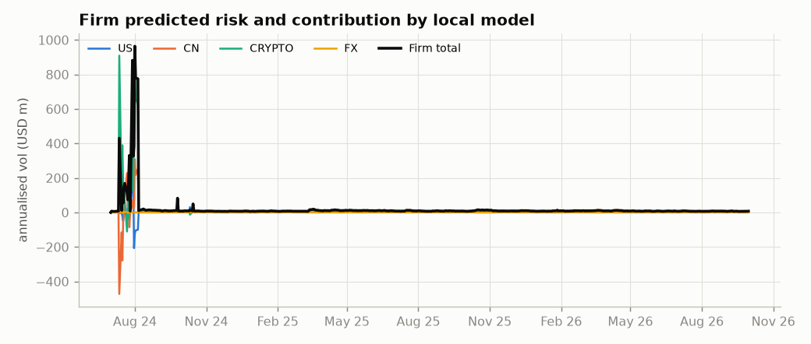
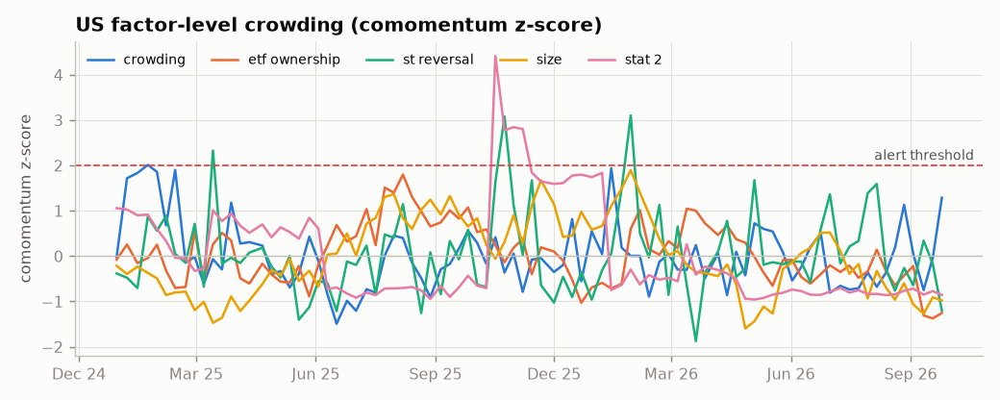

# Risk & Middle Office report - as of 2026-09-30

> **Decisions supported:** limit enforcement, escalation, de-risking during stress, new-strategy approval.

## Firm risk

- Gross exposure: **188.9m USD**; predicted daily vol **0.47m** (annualised 7.5m, 4.0% of gross); 1-day 99% normal VaR **1.10m**.
- Diversification benefit across local models: 0.32m daily vol.

| index | standalone_daily_vol | contribution_daily_vol | share |
|---|---|---|---|
| US | 0.33m | 0.22m | 47.1% |
| CN | 0.12m | 26,619 | 5.7% |
| CRYPTO | 0.34m | 0.22m | 47.3% |
| FX | 1,291 | 4 | 0.0% |

### Top firm-level factor risk contributors

| index | contribution_daily_vol | share_of_firm_vol |
|---|---|---|
| CRYPTO:funding | 0.10m | 22.3% |
| US:st_reversal | 53,777 | 11.4% |
| CRYPTO:sec_Smart Contract L1 | 50,397 | 10.7% |
| US:volatility | 31,287 | 6.6% |
| US:crowding | 28,195 | 6.0% |
| US:crypto_beta | 13,759 | 2.9% |
| CN:size | 12,994 | 2.8% |
| US:ind_Energy | 9,630 | 2.0% |
| US:retail_attention | 8,431 | 1.8% |
| CRYPTO:sec_Exchange Token | 7,790 | 1.7% |

## Limit status (latest day)

| strategy | limit | value | limit_value | utilisation | status | soft |
|---|---|---|---|---|---|---|
| B1_US_INTRADAY | style:size | 0.848 | 0.600 | 141.3% | BREACH ⛔ | no |
| B1_US_INTRADAY | shock_loss:vol_shock | 0.007 | 0.006 | 123.4% | BREACH ⛔ | no |
| B1_US_INTRADAY | industry_net_max | 0.125 | 0.120 | 103.8% | BREACH ⛔ | no |
| B1_US_INTRADAY | predicted_vol | 0.090 | 0.100 | 90.4% | WARN ⚠ | no |
| B1_US_INTRADAY | style:overnight_gap | 0.539 | 0.600 | 89.9% | WARN ⚠ | no |
| C1_US_EVENT | max_pct_adv | 0.211 | 0.150 | 141.0% | BREACH ⛔ | no |
| D1_US_CROWDING | style:crowding | 0.825 | 0.600 | 137.5% | BREACH ⛔ | no |
| D1_US_CROWDING | style:volatility | 0.501 | 0.600 | 83.5% | WARN ⚠ | no |
| E1_CRYPTO_CARRY | industry_net_max | 0.235 | 0.120 | 196.2% | BREACH ⛔ | no |
| E1_CRYPTO_CARRY | predicted_vol | 0.262 | 0.300 | 87.3% | WARN ⚠ | no |
| E1_CRYPTO_CARRY | style:funding | 0.490 | 0.600 | 81.6% | WARN ⚠ | no |

### Hard-limit breach episodes (history)

| date | strategy | limit | value | limit_value | utilisation | total_breach_days |
|---|---|---|---|---|---|---|
| 2026-09-04 | A1_US_STATARB | industry_net_max | 0.131 | 0.120 | 109.5% | 48 |
| 2026-09-05 | E1_CRYPTO_CARRY | style:momentum | 0.626 | 0.600 | 104.4% | 6 |
| 2026-09-05 | E1_CRYPTO_CARRY | predicted_vol | 0.305 | 0.300 | 101.6% | 105 |
| 2026-09-08 | B1_US_INTRADAY | style:beta | 0.611 | 0.600 | 101.8% | 28 |
| 2026-09-08 | A1_US_STATARB | style:st_reversal | 0.660 | 0.600 | 110.0% | 121 |
| 2026-09-09 | D1_US_CROWDING | style:volatility | 0.601 | 0.600 | 100.1% | 158 |
| 2026-09-09 | B1_US_INTRADAY | style:overnight_gap | 0.652 | 0.600 | 108.6% | 110 |
| 2026-09-10 | E1_CRYPTO_CARRY | beta_adj_net | 0.123 | 0.100 | 123.3% | 86 |
| 2026-09-10 | A2_CN_STATARB | industry_net_max | 0.126 | 0.120 | 104.8% | 16 |
| 2026-09-10 | B1_US_INTRADAY | style:size | 0.623 | 0.600 | 103.8% | 306 |
| 2026-09-11 | B1_US_INTRADAY | style:st_momentum | 0.768 | 0.600 | 128.0% | 57 |
| 2026-09-14 | B1_US_INTRADAY | industry_net_max | 0.125 | 0.120 | 103.9% | 130 |
| 2026-09-14 | A1_US_STATARB | max_pct_adv | 0.154 | 0.150 | 102.8% | 3 |
| 2026-09-15 | B1_US_INTRADAY | style:overnight_gap | 0.633 | 0.600 | 105.4% | 110 |
| 2026-09-15 | A2_CN_STATARB | predicted_vol | 0.102 | 0.100 | 101.5% | 150 |
| 2026-09-15 | A2_CN_STATARB | style:st_reversal | 0.607 | 0.600 | 101.1% | 15 |
| 2026-09-16 | E1_CRYPTO_CARRY | max_name | 0.121 | 0.120 | 100.7% | 31 |
| 2026-09-22 | E1_CRYPTO_CARRY | max_name | 0.124 | 0.120 | 103.0% | 31 |
| 2026-09-25 | B1_US_INTRADAY | shock_loss:vol_shock | 0.006 | 0.006 | 101.5% | 459 |
| 2026-09-28 | E1_CRYPTO_CARRY | beta_adj_net | 0.120 | 0.100 | 119.7% | 86 |
| 2026-09-28 | A2_CN_STATARB | industry_net_max | 0.121 | 0.120 | 101.1% | 16 |
| 2026-09-29 | E1_CRYPTO_CARRY | predicted_vol | 0.326 | 0.300 | 108.6% | 105 |
| 2026-09-29 | E1_CRYPTO_CARRY | style:btc_beta | 0.632 | 0.600 | 105.4% | 7 |
| 2026-09-30 | B1_US_INTRADAY | industry_net_max | 0.125 | 0.120 | 103.8% | 130 |
| 2026-09-30 | B1_US_INTRADAY | style:size | 0.848 | 0.600 | 141.3% | 306 |

## Strategy exposures

| strategy | as_of | gross | net_pct | beta_adj_net_pct | top_styles | stat_1 | pred_vol_ann_pct_gmv | factor_risk_share |
|---|---|---|---|---|---|---|---|---|
| A1_US_STATARB | 2026-09-30 | 59.27m | 0.0% | 1.5% | st_reversal +0.33, liquidity -0.26, overnight_gap -0.16 | 0.051 | 3.8% | 65.5% |
| A2_CN_STATARB | 2026-09-30 | 24.38m | -2.0% | -4.0% | size -0.37, overnight_gap -0.32, st_reversal +0.32 | 0.280 | 7.5% | 75.4% |
| B1_US_INTRADAY | 2026-09-30 | 5.97m | 2.6% | -1.5% | size -0.85, overnight_gap -0.54, volatility +0.42 | -0.238 | 9.0% | 81.0% |
| C1_US_EVENT | 2026-09-30 | 29.70m | 0.8% | -1.6% | liquidity -0.18, size +0.17, retail_attention +0.16 | -0.120 | 5.6% | 20.5% |
| D1_US_CROWDING | 2026-09-30 | 49.25m | -0.0% | -1.4% | crowding -0.82, volatility +0.50, size -0.27 | 0.100 | 6.5% | 85.6% |
| E1_CRYPTO_CARRY | 2026-09-30 | 20.33m | -0.5% | -7.8% | funding -0.49, btc_beta -0.26, momentum -0.09 | 0.362 | 26.2% | 71.4% |

Style exposures are in cross-sectional standard deviations per dollar of gross.

## Market-wide shock exposures (time-series factors)

Expected P&L (USD) for a 3-sigma move in each shock. *Model*: E[P&L | shock] from the factor covariance (includes co-moving factors such as reversal). *Empirical*: regression of daily P&L on the shock. Reversal books earn a liquidity premium and lose when volatility spikes or liquidity evaporates, even when every cross-sectional exposure looks neutral (Nagel 2012).

| strategy | fx (empirical) | fx (model) | liq_shock (empirical) | liq_shock (model) | rates (empirical) | rates (model) | us_session (empirical) | us_session (model) | vol_shock (empirical) | vol_shock (model) |
|---|---|---|---|---|---|---|---|---|---|---|
| A1_US_STATARB | -14,135 | -63,524 | -0.21m | -18,132 | -52,843 | -36,229 | – | – | -0.23m | 31,632 |
| A2_CN_STATARB | 8,615 | 40,115 | -69,771 | -25,756 | -9,138 | -6,079 | -34,106 | 32,349 | -85,332 | -34,930 |
| B1_US_INTRADAY | 192 | -4,559 | -54,693 | -9,192 | -3,322 | -3,227 | – | – | -99,776 | -35,258 |
| C1_US_EVENT | -21,159 | -12,091 | 93,101 | -1,834 | -58,709 | 5,087 | – | – | 0.10m | 12,837 |
| D1_US_CROWDING | -20,113 | -48,215 | -65,783 | -39,430 | -39,218 | -24,260 | – | – | -0.10m | -0.11m |

- Scheduled macro announcements scale macro-sensitive factor variance by a learned multiplier (latest 1.89x on US macro days).

## Stress tests (current holdings, USD)

### Hypothetical factor scenarios

The last column scales shocks on factors the crowding monitor flags as crowded.

| scenario | A1_US_STATARB | A2_CN_STATARB | B1_US_INTRADAY | C1_US_EVENT | D1_US_CROWDING | E1_CRYPTO_CARRY | FIRM | FIRM (crowding-scaled) |
|---|---|---|---|---|---|---|---|---|
| Aug-2007 quant deleveraging | -1.97m | -1.03m | 74,255 | -47,382 | -1.63m | -0.15m | -4.75m | -5.05m |
| Aug-2024 carry unwind | 0.10m | -60,319 | -54,473 | 65,173 | -0.34m | 47,620 | -0.24m | -0.30m |
| Jan-2021 short squeeze | -0.55m | -55,242 | 28,903 | 0.10m | -0.83m | 0 | -1.31m | -1.58m |
| Mar-2020 COVID crash | -0.22m | -66,824 | -30,820 | -34,746 | -0.53m | 0.43m | -0.46m | -0.54m |
| May-2022 LUNA collapse | -0.12m | 0 | 25,520 | -60,055 | -0.56m | 3.11m | 2.39m | 2.39m |
| Nov-2020 momentum/value rotation | 65,490 | 0.18m | -33,814 | 48,496 | 0.35m | 97,396 | 0.70m | 0.75m |
| Nov-2022 FTX failure | -40,940 | 0 | 8,507 | -20,018 | -0.19m | 1.31m | 1.07m | 1.07m |
| Rates shock / hawkish surprise | -30,512 | -4,913 | -17,357 | -9,116 | -71,544 | 0 | -0.13m | -0.13m |

### Historical factor replay (embedded stress days)

| episode | date | A1_US_STATARB | A2_CN_STATARB | B1_US_INTRADAY | C1_US_EVENT | D1_US_CROWDING | E1_CRYPTO_CARRY |
|---|---|---|---|---|---|---|---|
| Crypto liquidation cascade | 2025-10-10 | -0.97m | – | 33,319 | -59,317 | -1.11m | 0.60m |
| Global carry-trade unwind | 2024-08-05 | -1.18m | -0.47m | -1,377 | 0.16m | -1.50m | -0.43m |
| Momentum/value rotation | 2025-11-10 | -54,129 | -0.15m | -16,191 | 4,957 | 0.19m | – |
| Quant deleveraging | 2025-03-11 | -0.58m | -0.14m | -1,295 | 16,356 | -0.56m | – |
| Retail short squeeze | 2026-01-27 | -0.22m | – | 12,543 | -62,530 | -91,005 | – |
| Tariff shock / CN limit-down cascade | 2025-04-07 | -1.37m | -85,721 | -11,027 | -11,208 | -0.84m | 0.24m |

### Model-free replay (actual stock returns of the stress day on today's holdings)

| episode | date | A1_US_STATARB | A2_CN_STATARB | B1_US_INTRADAY | C1_US_EVENT | D1_US_CROWDING | E1_CRYPTO_CARRY |
|---|---|---|---|---|---|---|---|
| Crypto liquidation cascade | 2025-10-10 | -66,326 | – | -12,377 | -0.16m | -0.74m | 0.81m |
| Global carry-trade unwind | 2024-08-05 | 0.29m | -0.21m | -10,479 | 0.74m | -1.13m | 0.35m |
| Momentum/value rotation | 2025-11-10 | -0.18m | -0.14m | -24,640 | -0.12m | 47,075 | – |
| Quant deleveraging | 2025-03-11 | -0.17m | 89,065 | -47,026 | 0.61m | -0.67m | – |
| Retail short squeeze | 2026-01-27 | -81,778 | – | 35,188 | -0.83m | -0.28m | – |
| Tariff shock / CN limit-down cascade | 2025-04-07 | -0.15m | -87,258 | -73,376 | -13,910 | -0.68m | -0.11m |

### Liquidity stress (20% ADV participation, 3x spreads)

| strategy | gmv_usd | pct_gmv_liquid_1d | pct_gmv_over_5d | max_days_to_liquidate | stressed_liquidation_cost_usd | stressed_cost_bps_gmv |
|---|---|---|---|---|---|---|
| A1_US_STATARB | 61.34m | 100.0% | 0.0% | 0.269 | 80,477 | 13.120 |
| A2_CN_STATARB | 24.62m | 100.0% | 0.0% | 0.125 | 70,288 | 28.548 |
| B1_US_INTRADAY | 6.07m | 100.0% | 0.0% | 0.023 | 6,539 | 10.766 |
| C1_US_EVENT | 30.72m | 94.9% | 0.0% | 1.128 | 58,272 | 18.969 |
| D1_US_CROWDING | 51.20m | 100.0% | 0.0% | 0.396 | 77,783 | 15.193 |
| E1_CRYPTO_CARRY | 22.47m | 79.9% | 12.6% | 113 | 0.18m | 80.029 |

## Crowding

### 1. Short-side crowding (core factor)

Composite of short interest / float, days-to-cover, prime-broker borrow fee, borrow scarcity and lending utilisation; lagged to publication, standardised within market, cleaned of size, volatility and liquidity.

| market | marginal_r2 | pct_days_abs_t_gt_2 | ann_vol | resid_corr_reduction | max_abs_z_on_squeeze_days | decision | coverage |
|---|---|---|---|---|---|---|---|
| US | 0.013 | 0.402 | 4.3% | -0.022 | 5.366 | keep in core | 100.0% |
| CN | 0.009 | 0.156 | 4.4% | – | 0.352 | keep in core | 39.5% |

Coverage below 100% (CN) reflects names that cannot be borrowed; they score neutral.

### 2. Factor-level crowding (monitoring indicator)

Comomentum: average pairwise correlation of residual returns within each factor's top and bottom decile over 60 days (Lou and Polk), plus short interest in the short leg relative to the universe (Hanson and Sunderam). Flagged factors get larger stress shocks.

**US**

| factor | comomentum | z | si_short_leg_ratio | crowded | stress_multiplier |
|---|---|---|---|---|---|
| crowding | -0.005 | 1.289 | 0.289 | no | 1.322 |
| volatility | 0.003 | 0.533 | 0.868 | no | 1.133 |
| liquidity | -0.009 | 0.100 | 0.966 | no | 1.025 |
| overnight_gap | 0.010 | -0.114 | 1.080 | no | 1.000 |
| stat_1 | 0.058 | -0.285 | 0.817 | no | 1.000 |
| beta | 0.001 | -0.319 | 0.951 | no | 1.000 |
| retail_attention | -0.006 | -0.624 | 1.122 | no | 1.000 |
| st_momentum | 0.011 | -0.676 | 0.822 | no | 1.000 |
| stat_2 | 0.008 | -0.858 | 0.858 | no | 1.000 |
| size | -0.015 | -0.978 | 1.021 | no | 1.000 |
| st_reversal | 0.014 | -1.203 | 1.158 | no | 1.000 |
| etf_ownership | -0.016 | -1.255 | 1.103 | no | 1.000 |

**CN**

| factor | comomentum | z | si_short_leg_ratio | crowded | stress_multiplier |
|---|---|---|---|---|---|
| overnight_gap | 0.028 | 2.543 | 0.891 | yes | 1.636 |
| liquidity | -0.012 | 1.008 | 0.847 | no | 1.252 |
| etf_ownership | -0.019 | 0.902 | 0.796 | no | 1.226 |
| volatility | -0.001 | 0.600 | 0.618 | no | 1.150 |
| st_reversal | 0.021 | -0.094 | 0.744 | no | 1.000 |
| stat_1 | 0.038 | -0.243 | 1.608 | no | 1.000 |
| st_momentum | 0.008 | -0.465 | 1.423 | no | 1.000 |
| stat_2 | 0.020 | -0.648 | 0.769 | no | 1.000 |
| retail_attention | -0.011 | -0.654 | 0.923 | no | 1.000 |
| beta | -0.018 | -0.959 | 1.001 | no | 1.000 |
| size | -0.031 | -1.751 | 1.125 | no | 1.000 |
| crowding | -0.034 | -1.894 | 1.179 | no | 1.000 |

### 3. Internal crowding (liquidity stress)

Firm-wide positions summed across teams. No single team can see this risk.

| market | as_of | firm_gross_usd | names_held | names_2plus_teams_same_side | gross_in_shared_names_pct | max_firm_days_to_unwind | standalone_exit_cost_usd | joint_exit_cost_usd | crowding_premium_usd |
|---|---|---|---|---|---|---|---|---|---|
| US | 2026-09-30 | 149.33m | 281 | 177 | 77.3% | 0.958 | 0.14m | 0.16m | 22,046 |

**Largest firm positions relative to volume**

| market | ticker | firm_net_usd | firm_gross_usd | pct_adv | days_to_unwind | teams_same_side | strategies |
|---|---|---|---|---|---|---|---|
| US | U0024 | -1.39m | 2.49m | 19.2% | 0.958 | 2 | A1_US_STATARB,C1_US_EVENT,D1_US_CROWDING |
| US | U0041 | -0.75m | 1.11m | 12.4% | 0.622 | 1 | C1_US_EVENT,D1_US_CROWDING |
| US | U0240 | 0.54m | 0.54m | 7.4% | 0.368 | 2 | A1_US_STATARB,D1_US_CROWDING |
| US | U0069 | -0.71m | 0.71m | 6.5% | 0.327 | 3 | A1_US_STATARB,C1_US_EVENT,D1_US_CROWDING |
| US | U0014 | 1.31m | 1.31m | 5.5% | 0.275 | 2 | A1_US_STATARB,D1_US_CROWDING |
| US | U0059 | 0.52m | 0.52m | 5.3% | 0.266 | 2 | A1_US_STATARB,D1_US_CROWDING |
| US | U0288 | 0.48m | 0.48m | 4.7% | 0.234 | 2 | A1_US_STATARB,D1_US_CROWDING |
| US | U0022 | -0.67m | 1.94m | 4.4% | 0.219 | 2 | A1_US_STATARB,C1_US_EVENT,D1_US_CROWDING |
| US | U0037 | -1.20m | 1.20m | 4.4% | 0.219 | 3 | A1_US_STATARB,C1_US_EVENT,D1_US_CROWDING |
| US | U0215 | 0.45m | 0.45m | 3.6% | 0.179 | 2 | A1_US_STATARB,D1_US_CROWDING |
| US | U0084 | 0.47m | 0.74m | 3.5% | 0.175 | 1 | A1_US_STATARB,D1_US_CROWDING |
| US | U0030 | 0.41m | 0.67m | 3.4% | 0.169 | 1 | A1_US_STATARB,D1_US_CROWDING |
| US | U0176 | 0.82m | 0.97m | 3.4% | 0.168 | 2 | A1_US_STATARB,B1_US_INTRADAY,D1_US_CROWDING |
| US | U0277 | 0.15m | 0.15m | 3.2% | 0.161 | 1 | A1_US_STATARB |
| US | U0093 | 0.56m | 0.56m | 3.1% | 0.155 | 2 | A1_US_STATARB,D1_US_CROWDING |

## Exposure drift alerts (last 90 days)

| date | strategy | factor | z | exposure | baseline |
|---|---|---|---|---|---|
| 2026-07-20 | A2_CN_STATARB | us_session | -3.257 | -0.030 | 0.024 |
| 2026-07-28 | C1_US_EVENT | crowding | -3.683 | -0.531 | -0.022 |
| 2026-07-28 | C1_US_EVENT | stat_1 | -3.548 | -0.422 | 0.040 |
| 2026-07-30 | C1_US_EVENT | size | 3.547 | 0.115 | -0.124 |
| 2026-07-30 | C1_US_EVENT | fx | -4.081 | -0.042 | 0.044 |
| 2026-08-13 | C1_US_EVENT | beta | 3.588 | 0.069 | -0.265 |
| 2026-08-13 | C1_US_EVENT | beta_adj_net | 3.439 | 0.011 | -0.054 |
| 2026-08-14 | A1_US_STATARB | crowding | -3.233 | -0.269 | 0.070 |
| 2026-08-17 | D1_US_CROWDING | beta | -3.143 | -0.246 | -0.058 |
| 2026-09-08 | D1_US_CROWDING | vol_shock | 3.248 | -0.007 | -0.011 |
| 2026-09-16 | D1_US_CROWDING | rates | -3.057 | -0.004 | 0.081 |

## Model releases: material exposure changes (|t| > 3)

| strategy | version | release_date | factor | before | after | t_stat |
|---|---|---|---|---|---|---|
| A2_CN_STATARB | v2.3 | 2025-05-12 | crowding | -0.030 | 0.146 | 4.509 |
| A2_CN_STATARB | v2.3 | 2025-05-12 | fx | 0.101 | -0.045 | -8.282 |
| A2_CN_STATARB | v2.3 | 2025-05-12 | rates | -0.160 | 0.081 | 5.173 |
| A2_CN_STATARB | v2.3 | 2025-05-12 | size | 0.001 | -0.249 | -6.374 |
| D1_US_CROWDING | v2.0 | 2025-06-02 | beta | -0.179 | -0.222 | -3.783 |
| D1_US_CROWDING | v2.0 | 2025-06-02 | crowding | -1.025 | -0.901 | 7.711 |
| D1_US_CROWDING | v2.0 | 2025-06-02 | fx | -0.121 | -0.095 | 3.339 |
| D1_US_CROWDING | v2.0 | 2025-06-02 | liq_shock | -0.002 | -0.002 | -5.174 |
| D1_US_CROWDING | v2.0 | 2025-06-02 | liquidity | 0.125 | 0.062 | -7.093 |
| D1_US_CROWDING | v2.0 | 2025-06-02 | size | 0.053 | -0.137 | -14.685 |
| D1_US_CROWDING | v2.0 | 2025-06-02 | st_reversal | 0.095 | -0.020 | -3.211 |
| D1_US_CROWDING | v2.0 | 2025-06-02 | vol_shock | 0.002 | -0.004 | -10.157 |
| D1_US_CROWDING | v2.0 | 2025-06-02 | volatility | -0.038 | 0.443 | 10.695 |
| A1_US_STATARB | v3.2 | 2025-09-15 | beta | -0.070 | 0.064 | 3.248 |
| A1_US_STATARB | v3.2 | 2025-09-15 | beta_adj_net | -0.014 | 0.016 | 3.434 |
| A1_US_STATARB | v3.2 | 2025-09-15 | fx | -0.082 | 0.002 | 4.018 |
| A1_US_STATARB | v3.2 | 2025-09-15 | liq_shock | -0.002 | -0.001 | 3.049 |
| A1_US_STATARB | v3.2 | 2025-09-15 | rates | 0.041 | 0.166 | 3.388 |
| E1_CRYPTO_CARRY | v1.6 | 2025-12-01 | funding | -0.646 | -0.436 | 4.277 |
| E1_CRYPTO_CARRY | v1.6 | 2025-12-01 | momentum | -0.122 | 0.074 | 4.038 |
| C1_US_EVENT | v1.4 | 2026-01-12 | beta | -0.411 | -0.176 | 4.773 |
| C1_US_EVENT | v1.4 | 2026-01-12 | beta_adj_net | -0.106 | -0.053 | 3.677 |
| C1_US_EVENT | v1.4 | 2026-01-12 | crowding | 0.061 | 0.147 | 3.031 |
| C1_US_EVENT | v1.4 | 2026-01-12 | fx | 0.061 | -0.006 | -3.398 |
| C1_US_EVENT | v1.4 | 2026-01-12 | liquidity | 0.061 | -0.064 | -4.034 |
| C1_US_EVENT | v1.4 | 2026-01-12 | overnight_gap | -0.054 | 0.454 | 4.016 |
| C1_US_EVENT | v1.4 | 2026-01-12 | rates | -0.256 | -0.118 | 4.587 |
| C1_US_EVENT | v1.4 | 2026-01-12 | st_reversal | 0.029 | -0.325 | -3.309 |

## Cross-team stacking (30-day average exposures on shared factor names)

Stacking ratio near 1 = teams hold the same tilt; near 0 = they offset.

| factor | firm_exposure_usd | sum_abs_strategy | stacking_ratio |
|---|---|---|---|
| crowding | -38.94m | 41.43m | 94.0% |
| st_reversal | 32.08m | 40.47m | 79.3% |
| size | -25.41m | 35.64m | 71.3% |
| volatility | 23.92m | 31.28m | 76.5% |
| stat_1 | 14.30m | 21.88m | 65.3% |
| liquidity | -10.34m | 20.22m | 51.2% |
| st_momentum | -3.67m | 17.35m | 21.1% |
| beta | -9.56m | 16.91m | 56.5% |
| beta_adj_net | -1.19m | 3.87m | 30.9% |

## Reconciliation to official P&L

- Strategy-days reconciled: 3,632; within tolerance: 99.83%; median |unexplained| $17.

| date | strategy | official | total_attributed | unexplained | tolerance | break |
|---|---|---|---|---|---|---|
| 2024-07-01 | D1_US_CROWDING | -5,346 | -2,208 | -3,137 | 1,000 | yes |
| 2024-07-23 | A2_CN_STATARB | 48,849 | 43,911 | 4,937 | 1,308 | yes |
| 2024-10-02 | B1_US_INTRADAY | -25,423 | -12,648 | -12,775 | 1,000 | yes |
| 2025-02-21 | C1_US_EVENT | 0.13m | 0.15m | -27,367 | 1,475 | yes |
| 2026-01-28 | A1_US_STATARB | 0.19m | 0.16m | 29,672 | 3,049 | yes |
| 2026-08-05 | E1_CRYPTO_CARRY | -99,280 | -0.10m | 1,391 | 1,000 | yes |

## Data quality

- US: 9 flagged observations; CN: 0 flagged observations (large moves without corporate action - verified against resumption-from-suspension and stress days).
