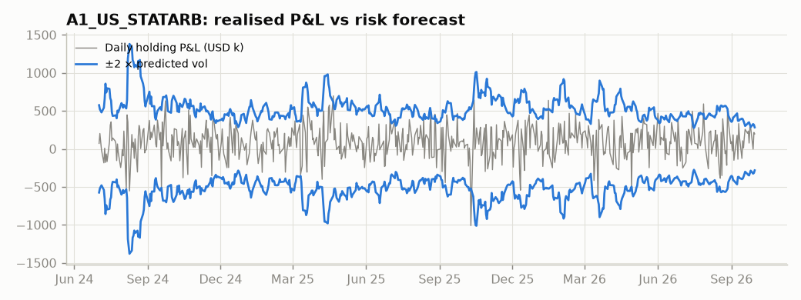
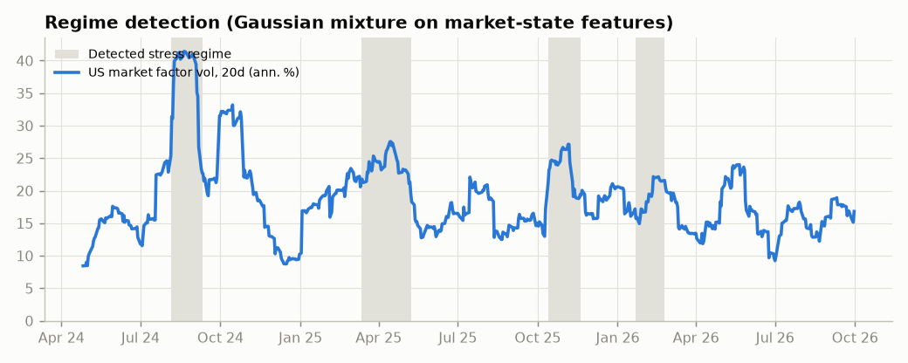
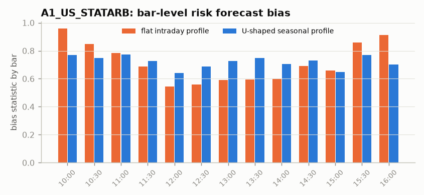
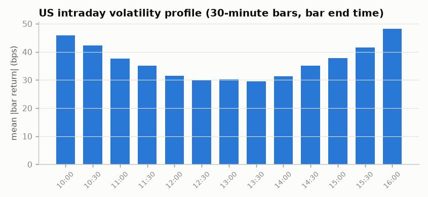

# Model validation report

> **Question answered:** are the risk forecasts calibrated, does attribution reconcile, and is anything missing?

## 1. Explanatory power

| index | named | hybrid |
|---|---|---|
| US | 0.308 | 0.337 |
| CN | 0.363 | 0.382 |
| CRYPTO | 0.430 | 0.448 |

| strategy | factor_share_of_hold_var | corr_factor_vs_hold |
|---|---|---|
| A1_US_STATARB | 84.3% | 0.914 |
| A2_CN_STATARB | 77.0% | 0.868 |
| B1_US_INTRADAY | 76.3% | 0.866 |
| C1_US_EVENT | 52.5% | 0.722 |
| D1_US_CROWDING | 87.9% | 0.937 |
| E1_CRYPTO_CARRY | 17.0% | 0.534 |

## 2. Calibration: bias statistics (target 1, band 1 ± √(2/T))

### Strategy portfolios (most important)

| strategy | mean_bias | within_band_pct | band | n_windows | realised_vol_ann | pred_vol_ann |
|---|---|---|---|---|---|---|
| A1_US_STATARB | 0.810 | 37.5% | 0.178 | 8 | 3.38m | 4.27m |
| A2_CN_STATARB | 0.838 | 50.0% | 0.178 | 8 | 1.90m | 2.24m |
| B1_US_INTRADAY | 0.838 | 62.5% | 0.178 | 8 | 0.46m | 0.55m |
| C1_US_EVENT | 0.934 | 100.0% | 0.178 | 8 | 2.67m | 2.69m |
| D1_US_CROWDING | 0.850 | 50.0% | 0.178 | 8 | 3.10m | 3.67m |
| E1_CRYPTO_CARRY | 0.725 | 15.4% | 0.178 | 13 | 3.35m | 4.71m |

### Factors

**US**

| group | mean_bias | within_band_pct |
|---|---|---|
| event | 1.514 | 16.7% |
| industry | 1.089 | 73.7% |
| market | 1.168 | 33.3% |
| market_specific | 1.172 | 55.6% |
| statistical | 0.746 | 18.8% |
| style | 0.818 | 47.8% |
| timeseries | 1.015 | 52.8% |

**CN**

| group | mean_bias | within_band_pct |
|---|---|---|
| event | 1.221 | 50.0% |
| industry | 1.069 | 74.4% |
| market | 1.218 | 55.6% |
| market_specific | 1.037 | 50.0% |
| statistical | 0.764 | 14.3% |
| style | 0.829 | 61.1% |
| timeseries | 0.992 | 31.1% |

**CRYPTO**

| group | mean_bias | within_band_pct |
|---|---|---|
| event | – | – |
| industry | 1.056 | 73.0% |
| market | 1.088 | 35.7% |
| statistical | 0.958 | 53.8% |
| style | 0.943 | 83.9% |

### Specific risk

| index | mean_bias | within_band_pct | band | n_windows |
|---|---|---|---|---|
| US | 1.007 | 69.5% | 0.178 | 1,336 |
| CN | 1.026 | 84.0% | 0.178 | 1,335 |
| CRYPTO | 1.103 | 58.2% | 0.178 | 600 |

## 3. Benchmark comparison (challengers)

The in-house model must beat a market+industry baseline and a pure PCA model on calibration and explanatory power.

| model | n_factors | mean_cs_r2 | strategy_bias_mean | strategy_bias_mad_from_1 | strategy_within_band_pct | first_valid |
|---|---|---|---|---|---|---|
| in-house core (named + statistical) | 34 | 0.337 | 0.858 | 0.142 | 62.5% | 2024-04-01 |
| baseline: market + industry | 12 | 0.167 | 1.496 | 0.496 | 21.9% | 2024-04-01 |
| challenger: PCA (10 factors) | 11 | 0.196 | 1.205 | 0.205 | 53.1% | 2024-06-25 |

## 4. Recovery of the simulated factor returns (synthetic data only)

**US**

| factor | corr_with_true | n |
|---|---|---|
| market | 0.835 | 628 |
| ind_Technology | 0.729 | 628 |
| ind_Semiconductors | 0.616 | 628 |
| ind_Communication | 0.787 | 628 |
| ind_Consumer Discretionary | 0.697 | 628 |
| ind_Consumer Staples | 0.723 | 628 |
| ind_Health Care | 0.789 | 628 |
| ind_Financials | 0.729 | 628 |
| ind_Industrials | 0.794 | 628 |
| ind_Energy | 0.786 | 628 |
| ind_Materials | 0.715 | 628 |
| ind_Utilities | 0.780 | 628 |
| size | 0.614 | 628 |
| liquidity | 0.740 | 628 |
| volatility | 0.861 | 628 |
| st_reversal | 0.724 | 628 |
| st_momentum | 0.589 | 628 |
| overnight_gap | 0.579 | 628 |
| crowding | 0.859 | 628 |
| retail_attention | 0.703 | 628 |
| earnings | 0.293 | 207 |
| option_expiry | 0.521 | 30 |
| corporate_action | – | 30 |
| in_play | 0.255 | 66 |
| crypto_beta | 0.888 | 628 |
| stat_1 vs hidden theme | 0.824 | 508 |
| stat_2 vs hidden theme | 0.319 | 508 |

**CN**

| factor | corr_with_true | n |
|---|---|---|
| market | 0.894 | 606 |
| ind_Banks | 0.796 | 606 |
| ind_Non-bank Financials | 0.719 | 606 |
| ind_Electronics | 0.725 | 606 |
| ind_Computers | 0.694 | 606 |
| ind_Pharma | 0.725 | 606 |
| ind_Food & Beverage | 0.673 | 606 |
| ind_Machinery | 0.709 | 606 |
| ind_Autos | 0.756 | 606 |
| ind_Chemicals | 0.768 | 606 |
| ind_Real Estate | 0.784 | 606 |
| size | 0.633 | 606 |
| liquidity | 0.592 | 606 |
| volatility | 0.842 | 606 |
| st_reversal | 0.717 | 606 |
| st_momentum | 0.486 | 606 |
| overnight_gap | 0.537 | 606 |
| crowding | 0.624 | 606 |
| retail_attention | 0.681 | 606 |
| earnings | 0.095 | 130 |
| option_expiry | 0.390 | 30 |
| corporate_action | – | 37 |
| limit_hit | 0.465 | 188 |
| stat_1 vs hidden theme | 0.074 | 486 |
| stat_2 vs hidden theme | 0.047 | 486 |

## 4b. Factor selection tests (Section 2.1)

Each factor must earn its place on our own data. Core factors: drop-one marginal R² (on the affected stock-days for sparse event factors) and share of estimable days with |t| > 2. Time-series factors: share of remaining variance explained by B·g (their cross-sectional R² is understated because industry factors absorb their sector pattern). Candidates: add-one. Residual correlation reduction is across this market's strategies.

| market | factor | test | marginal_r2 | pct_days_abs_t_gt_2 | ann_vol | resid_corr_reduction | max_abs_z_on_squeeze_days | decision |
|---|---|---|---|---|---|---|---|---|
| US | beta | core (drop-one) | 0.011 | 0.331 | 5.4% | -0.003 | 2.449 | keep in core |
| US | size | core (drop-one) | 0.018 | 0.480 | 6.2% | -0.013 | 0.296 | keep in core |
| US | liquidity | core (drop-one) | 0.007 | 0.248 | 3.2% | -0.006 | 4.398 | keep in core |
| US | volatility | core (drop-one) | 0.016 | 0.450 | 5.3% | 0.028 | 4.341 | keep in core |
| US | st_reversal | core (drop-one) | 0.008 | 0.274 | 8.5% | 0.021 | 2.924 | keep in core |
| US | st_momentum | core (drop-one) | 0.006 | 0.219 | 5.2% | -0.007 | 0.892 | keep in core |
| US | overnight_gap | core (drop-one) | 0.006 | 0.175 | 5.3% | 0.022 | 1.271 | keep in core |
| US | crowding | core (drop-one) | 0.013 | 0.402 | 4.3% | -0.022 | 5.366 | keep in core |
| US | etf_ownership | core (drop-one) | 0.007 | 0.262 | 3.2% | -0.003 | 0.970 | keep in core |
| US | retail_attention | core (drop-one) | 0.006 | 0.188 | 2.9% | -0.001 | 2.313 | keep in core |
| US | earnings | core (drop-one, affected stock-days) | 0.075 | 0.401 | 20.8% | -0.001 | 0.427 | keep in core |
| US | index_rebalance | core (drop-one, affected stock-days) | 0.089 | 0.000 | 13.9% | -0.000 | – | review: move to monitoring layer |
| US | option_expiry | core (drop-one, affected stock-days) | 0.006 | 0.111 | 10.8% | 0.000 | – | review: move to monitoring layer |
| US | corporate_action | core (drop-one, affected stock-days) | 0.026 | 0.111 | 5.7% | 0.000 | – | review: move to monitoring layer |
| US | in_play | core (drop-one, affected stock-days) | 0.082 | 0.220 | 30.3% | 0.001 | 0.967 | keep in core |
| US | crypto_beta | core (drop-one, affected stock-days) | 0.265 | 0.361 | 56.5% | 0.002 | 1.741 | keep in core |
| US | vol_shock | time-series (variance explained) | 0.021 | – | 138.5% | -0.031 | 3.495 | keep in core |
| US | liq_shock | time-series (variance explained) | 0.004 | – | 167.6% | -0.000 | 5.378 | keep in core |
| US | fx | time-series (variance explained) | 0.015 | – | 7.5% | 0.007 | 0.499 | keep in core |
| US | rates | time-series (variance explained) | 0.039 | – | 7.4% | -0.002 | 0.402 | keep in core |
| CN | beta | core (drop-one) | 0.017 | 0.302 | 8.5% | – | 0.791 | keep in core |
| CN | size | core (drop-one) | 0.027 | 0.425 | 9.2% | – | 1.617 | keep in core |
| CN | liquidity | core (drop-one) | 0.009 | 0.156 | 4.4% | – | 3.584 | keep in core |
| CN | volatility | core (drop-one) | 0.023 | 0.391 | 7.6% | – | 0.342 | keep in core |
| CN | st_reversal | core (drop-one) | 0.013 | 0.235 | 12.8% | – | 0.243 | keep in core |
| CN | st_momentum | core (drop-one) | 0.008 | 0.140 | 7.6% | – | 0.509 | keep in core |
| CN | overnight_gap | core (drop-one) | 0.008 | 0.142 | 7.7% | – | 1.890 | keep in core |
| CN | crowding | core (drop-one) | 0.009 | 0.156 | 4.4% | – | 0.352 | keep in core |
| CN | etf_ownership | core (drop-one) | 0.010 | 0.175 | 4.9% | – | 1.826 | keep in core |
| CN | retail_attention | core (drop-one) | 0.010 | 0.155 | 4.4% | – | 0.415 | keep in core |
| CN | earnings | core (drop-one, affected stock-days) | 0.096 | 0.299 | 30.3% | – | – | keep in core |
| CN | index_rebalance | core (drop-one, affected stock-days) | 0.257 | 0.286 | 27.8% | – | – | keep in core |
| CN | option_expiry | core (drop-one, affected stock-days) | 0.009 | 0.000 | 13.2% | – | – | review: move to monitoring layer |
| CN | corporate_action | core (drop-one, affected stock-days) | 0.147 | 0.129 | 20.0% | – | – | review: move to monitoring layer |
| CN | in_play | core (drop-one, affected stock-days) | 0.018 | 0.000 | – | – | – | review: move to monitoring layer |
| CN | limit_hit | core (drop-one, affected stock-days) | 0.194 | 0.200 | 31.6% | – | – | keep in core |
| CN | vol_shock | time-series (variance explained) | 0.012 | – | 129.7% | – | 3.708 | keep in core |
| CN | liq_shock | time-series (variance explained) | 0.003 | – | 148.2% | – | 5.017 | keep in core |
| CN | fx | time-series (variance explained) | 0.006 | – | 3.3% | – | 0.086 | keep in core |
| CN | rates | time-series (variance explained) | 0.010 | – | 2.4% | – | 0.409 | keep in core |
| CN | us_session | time-series (variance explained) | 0.015 | – | 20.6% | – | 1.918 | keep in core |

### Time-series betas: shrinkage and stability (Section 3.4)

**US**

| factor | monthly_stability | mean_shrink_weight | corr_shrunk_vs_true | corr_raw_vs_true |
|---|---|---|---|---|
| vol_shock | 0.908 | 0.759 | 0.803 | 0.832 |
| liq_shock | 0.800 | 0.431 | 0.019 | 0.139 |
| fx | 0.940 | 0.451 | 0.835 | 0.804 |
| rates | 0.977 | 0.517 | 0.930 | 0.925 |

**CN**

| factor | monthly_stability | mean_shrink_weight | corr_shrunk_vs_true | corr_raw_vs_true |
|---|---|---|---|---|
| vol_shock | 0.891 | 0.646 | 0.570 | 0.654 |
| liq_shock | 0.787 | 0.283 | 0.223 | 0.336 |
| fx | 0.906 | 0.191 | 0.730 | 0.550 |
| rates | 0.956 | 0.193 | 0.924 | 0.672 |
| us_session | 0.924 | 0.344 | 0.729 | 0.642 |

Shrinking noisy time-series betas toward the industry average raises their correlation with the true sensitivities where individual estimates are noisiest.

### Risk-model settings in use

| index | ledoit_wolf_intensity | macro_day_multiplier |
|---|---|---|
| US | 0.250 | 1.749 |
| CN | 0.250 | 1.276 |
| CRYPTO | 0.236 | – |

## 5. Factor quality and collinearity

**US**

| factor | group | ann_vol | ann_return | t_mean | pct_days_abs_t_gt_2 | autocorr_1 |
|---|---|---|---|---|---|---|
| market | market | 0.195 | 0.216 | 1.745 | 0.742 | 0.004 |
| beta | style | 0.053 | 0.029 | 0.868 | 0.298 | -0.027 |
| size | style | 0.062 | 0.102 | 2.573 | 0.441 | 0.025 |
| liquidity | style | 0.031 | -0.023 | -1.147 | 0.226 | 0.034 |
| volatility | style | 0.052 | 0.008 | 0.230 | 0.409 | 0.019 |
| st_reversal | style | 0.084 | 0.156 | 2.938 | 0.244 | 0.017 |
| st_momentum | style | 0.051 | 0.020 | 0.621 | 0.192 | -0.023 |
| overnight_gap | style | 0.053 | -0.008 | -0.232 | 0.158 | 0.050 |
| crowding | style | 0.043 | -0.018 | -0.646 | 0.361 | -0.057 |
| etf_ownership | style | 0.032 | -0.029 | -1.412 | 0.237 | 0.074 |
| retail_attention | style | 0.028 | -0.010 | -0.554 | 0.167 | -0.024 |
| earnings | event | 0.211 | 0.571 | 2.452 | 0.120 | 0.002 |
| option_expiry | event | 0.104 | -0.165 | -0.546 | 0.004 | -0.023 |
| corporate_action | event | 0.056 | -0.323 | -1.988 | 0.004 | 0.154 |
| in_play | event | 0.324 | -0.112 | -0.177 | 0.022 | -0.030 |
| crypto_beta | market_specific | 0.582 | 0.247 | 0.669 | 0.335 | 0.039 |
| vol_shock | timeseries | 1.309 | 0.007 | 0.009 | 0.000 | -0.166 |
| liq_shock | timeseries | 1.597 | 0.020 | 0.020 | 0.000 | -0.255 |
| fx | timeseries | 0.074 | -0.003 | -0.064 | 0.000 | -0.018 |
| rates | timeseries | 0.073 | 0.035 | 0.796 | 0.000 | 0.085 |
| stat_1 | statistical | 0.030 | 0.001 | 0.044 | 0.000 | 0.083 |
| stat_2 | statistical | 0.022 | 0.005 | 0.339 | 0.000 | 0.036 |

**CN**

| factor | group | ann_vol | ann_return | t_mean | pct_days_abs_t_gt_2 | autocorr_1 |
|---|---|---|---|---|---|---|
| market | market | 0.278 | 0.147 | 0.819 | 0.718 | 0.022 |
| beta | style | 0.083 | -0.032 | -0.601 | 0.265 | 0.051 |
| size | style | 0.092 | 0.034 | 0.581 | 0.384 | 0.019 |
| liquidity | style | 0.043 | 0.024 | 0.839 | 0.142 | 0.022 |
| volatility | style | 0.075 | -0.074 | -1.536 | 0.351 | 0.006 |
| st_reversal | style | 0.127 | 0.109 | 1.320 | 0.217 | -0.022 |
| st_momentum | style | 0.076 | -0.000 | -0.002 | 0.124 | 0.023 |
| overnight_gap | style | 0.076 | -0.087 | -1.764 | 0.127 | -0.019 |
| crowding | style | 0.043 | -0.028 | -0.998 | 0.135 | 0.000 |
| etf_ownership | style | 0.049 | -0.017 | -0.538 | 0.160 | -0.014 |
| retail_attention | style | 0.044 | 0.026 | 0.914 | 0.142 | 0.030 |
| earnings | event | 0.314 | 0.053 | 0.121 | 0.060 | 0.077 |
| option_expiry | event | 0.135 | -0.372 | -0.950 | 0.000 | 0.054 |
| corporate_action | event | 0.189 | -0.132 | -0.267 | 0.006 | -0.245 |
| limit_hit | market_specific | 0.313 | 3.183 | 8.774 | 0.060 | 0.024 |
| vol_shock | timeseries | 1.252 | 0.055 | 0.071 | 0.000 | -0.210 |
| liq_shock | timeseries | 1.418 | 0.028 | 0.032 | 0.000 | -0.238 |
| fx | timeseries | 0.033 | -0.006 | -0.313 | 0.000 | -0.079 |
| rates | timeseries | 0.025 | -0.010 | -0.664 | 0.000 | 0.001 |
| us_session | timeseries | 0.195 | 0.189 | 1.544 | 0.000 | -0.006 |
| stat_1 | statistical | 0.037 | 0.008 | 0.293 | 0.000 | -0.020 |
| stat_2 | statistical | 0.031 | 0.024 | 1.077 | 0.000 | 0.005 |

**CRYPTO**

| factor | group | ann_vol | ann_return | t_mean | pct_days_abs_t_gt_2 | autocorr_1 |
|---|---|---|---|---|---|---|
| market | market | 0.707 | 0.347 | 0.963 | 0.676 | -0.047 |
| btc_beta | style | 0.202 | 0.035 | 0.345 | 0.194 | -0.040 |
| size | style | 0.176 | -0.015 | -0.162 | 0.101 | 0.013 |
| momentum | style | 0.301 | 0.256 | 1.671 | 0.213 | -0.037 |
| funding | style | 0.246 | 0.003 | 0.024 | 0.176 | -0.058 |
| stat_1 | statistical | 0.088 | 0.052 | 1.095 | 0.000 | 0.015 |

**VIF US** (flag > 5)

| index | mean_vif | max_vif |
|---|---|---|
| beta | 1.375 | 2.054 |
| size | 1.395 | 1.810 |
| liquidity | 1.073 | 1.163 |
| volatility | 1.082 | 1.449 |
| st_reversal | 5.504 | 28.097 |
| st_momentum | 2.944 | 12.765 |
| overnight_gap | 3.126 | 9.110 |
| crowding | 1.060 | 1.573 |
| etf_ownership | 1.105 | 1.244 |
| retail_attention | 1.064 | 1.388 |

**VIF CN** (flag > 5)

| index | mean_vif | max_vif |
|---|---|---|
| beta | 1.269 | 1.713 |
| size | 1.299 | 2.061 |
| liquidity | 1.088 | 1.204 |
| volatility | 1.115 | 1.355 |
| st_reversal | 5.310 | 11.708 |
| st_momentum | 2.889 | 6.040 |
| overnight_gap | 3.184 | 5.622 |
| crowding | 1.044 | 1.136 |
| etf_ownership | 1.120 | 1.244 |
| retail_attention | 1.073 | 1.211 |

**Exposure stability US** (day-on-day cross-sectional correlation)

| index | day_on_day_corr |
|---|---|
| beta | 0.996 |
| size | 1.000 |
| liquidity | 0.998 |
| volatility | 0.966 |
| st_reversal | 0.778 |
| st_momentum | 0.650 |
| overnight_gap | 0.782 |
| crowding | 0.978 |
| etf_ownership | 0.999 |
| retail_attention | 0.138 |

**Exposure stability CN** (day-on-day cross-sectional correlation)

| index | day_on_day_corr |
|---|---|
| beta | 0.997 |
| size | 1.000 |
| liquidity | 0.998 |
| volatility | 0.967 |
| st_reversal | 0.781 |
| st_momentum | 0.653 |
| overnight_gap | 0.780 |
| crowding | 0.932 |
| etf_ownership | 0.999 |
| retail_attention | 0.060 |

## 6. Missing-factor tests

### Residual correlation across strategies

Named factors only:

| a | b | rho | p_value | flag |
|---|---|---|---|---|
| A1_US_STATARB | D1_US_CROWDING | 0.238 | 0.000 | yes |
| A1_US_STATARB | C1_US_EVENT | 0.140 | 0.001 | no |
| B1_US_INTRADAY | D1_US_CROWDING | -0.115 | 0.005 | no |
| A2_CN_STATARB | D1_US_CROWDING | -0.089 | 0.032 | no |
| B1_US_INTRADAY | E1_CRYPTO_CARRY | 0.068 | 0.099 | no |
| B1_US_INTRADAY | C1_US_EVENT | 0.062 | 0.135 | no |
| D1_US_CROWDING | E1_CRYPTO_CARRY | -0.058 | 0.159 | no |
| C1_US_EVENT | D1_US_CROWDING | 0.046 | 0.267 | no |

Core model (named + statistical):

| a | b | rho | p_value | flag |
|---|---|---|---|---|
| A1_US_STATARB | D1_US_CROWDING | 0.184 | 0.000 | yes |
| B1_US_INTRADAY | D1_US_CROWDING | -0.106 | 0.010 | no |
| A1_US_STATARB | C1_US_EVENT | 0.088 | 0.033 | no |
| A2_CN_STATARB | D1_US_CROWDING | -0.075 | 0.069 | no |
| B1_US_INTRADAY | E1_CRYPTO_CARRY | 0.068 | 0.101 | no |
| B1_US_INTRADAY | C1_US_EVENT | 0.068 | 0.101 | no |
| A1_US_STATARB | A2_CN_STATARB | -0.044 | 0.287 | no |
| A2_CN_STATARB | B1_US_INTRADAY | 0.039 | 0.346 | no |

### PCA on US named-model residuals (last 250 days, 287 stocks)

Marchenko-Pastur edge 4.29; eigenvalues above edge: **7**; after statistical factors: 6.

| index | eigenvalue |
|---|---|
| 1.000 | 8.335 |
| 2.000 | 6.371 |
| 3.000 | 5.803 |
| 4.000 | 5.419 |
| 5.000 | 4.984 |

| pc | candidate | corr |
|---|---|---|
| 1 | theme:AI infrastructure | -0.578 |
| 1 | slow:value | 0.085 |
| 1 | sector:Communication | 0.071 |
| 2 | slow:value | -0.097 |
| 2 | slow:momentum_12_1 | 0.092 |
| 2 | sector:Industrials | -0.052 |
| 3 | slow:value | -0.280 |
| 3 | slow:earnings_yield | -0.244 |
| 3 | theme:AI infrastructure | 0.195 |
| 4 | slow:value | -0.270 |
| 4 | slow:earnings_yield | -0.187 |
| 4 | theme:AI infrastructure | -0.159 |
| 5 | slow:value | -0.134 |
| 5 | slow:earnings_yield | -0.102 |
| 5 | sector:Financials | -0.086 |

### PCA on CN named-model residuals (last 250 days, 152 stocks)

Marchenko-Pastur edge 3.17; eigenvalues above edge: **2**; after statistical factors: 1.

| index | eigenvalue |
|---|---|
| 1.000 | 3.821 |
| 2.000 | 3.488 |
| 3.000 | 3.128 |
| 4.000 | 3.000 |
| 5.000 | 2.942 |

| pc | candidate | corr |
|---|---|---|
| 1 | slow:momentum_12_1 | -0.272 |
| 1 | shortable | 0.135 |
| 1 | slow:long_term_reversal | 0.086 |
| 2 | slow:value | -0.386 |
| 2 | slow:earnings_yield | -0.376 |
| 2 | slow:long_term_reversal | -0.162 |
| 3 | slow:momentum_12_1 | -0.259 |
| 3 | sector:Autos | 0.101 |
| 3 | slow:earnings_yield | 0.087 |
| 4 | slow:momentum_12_1 | -0.088 |
| 4 | shortable | -0.068 |
| 4 | slow:long_term_reversal | -0.055 |
| 5 | slow:long_term_reversal | -0.103 |
| 5 | sector:Non-bank Financials | 0.100 |
| 5 | sector:Real Estate | -0.068 |

### Shared residual shocks (≥3 strategies below -2σ on the same day)

None.

## 7. Regimes and cross-market structure

- Regime classification accuracy vs simulated truth: 87.7%.

| leader | follower | corr_same_day | corr_leader_lag1 |
|---|---|---|---|
| US:market | CN:market | -0.002 | 0.161 |
| US:market | CRYPTO:market | 0.050 | 0.012 |
| CRYPTO:market | US:crypto_beta | 0.657 | 0.027 |
| US:crypto_beta | CRYPTO:market | 0.657 | 0.019 |

CN market follows the previous US session; the global layer's Newey-West lag term captures this.

## 8. Historical event replay

Did forecasts flag the risk beforehand, and does attribution explain the loss afterwards?

| episode | date | strategy | pred_vol_t-1 | pred_vol_month_before | forecast_rose_pct | hold_pnl | z_score | factor | specific | trading_and_costs | factor_share_of_loss |
|---|---|---|---|---|---|---|---|---|---|---|---|
| Global carry-trade unwind | 2024-08-05 | A1_US_STATARB | 265,949 | 290,134 | -8.336 | -0.52m | -1.938 | -0.79m | 0.28m | -51,013 | 152.9% |
| Global carry-trade unwind | 2024-08-05 | B1_US_INTRADAY | 45,373 | 33,316 | 36.190 | -80,709 | -1.779 | -0.12m | 40,899 | -0.32m | 151.9% |
| Global carry-trade unwind | 2024-08-05 | C1_US_EVENT | 135,923 | 257,575 | -47.230 | 0.77m | 5.699 | 0.42m | 0.35m | -0.13m | – |
| Global carry-trade unwind | 2024-08-05 | D1_US_CROWDING | 212,472 | 182,443 | 16.460 | -0.35m | -1.654 | -0.20m | -0.15m | -51,847 | 58.0% |
| Quant deleveraging | 2025-03-11 | A1_US_STATARB | 177,443 | 227,047 | -21.847 | -0.34m | -1.899 | -0.23m | -0.12m | -0.13m | 69.1% |
| Quant deleveraging | 2025-03-11 | B1_US_INTRADAY | 31,480 | 29,584 | 6.407 | -49,593 | -1.575 | -37,423 | -11,210 | -0.16m | 75.5% |
| Quant deleveraging | 2025-03-11 | C1_US_EVENT | 201,002 | 179,843 | 11.765 | 0.18m | 0.879 | 0.25m | -56,413 | -92 | – |
| Quant deleveraging | 2025-03-11 | D1_US_CROWDING | 188,858 | 191,411 | -1.334 | -0.48m | -2.541 | -0.40m | -86,924 | -21,111 | 83.0% |
| Tariff shock / CN limit-down cascade | 2025-04-07 | A1_US_STATARB | 252,002 | 288,851 | -12.757 | -0.40m | -1.590 | -0.34m | -28,425 | -0.21m | 83.8% |
| Tariff shock / CN limit-down cascade | 2025-04-07 | B1_US_INTRADAY | 38,131 | 36,260 | 5.161 | -0.10m | -2.726 | -0.11m | 8,487 | -0.51m | 108.1% |
| Tariff shock / CN limit-down cascade | 2025-04-07 | C1_US_EVENT | 226,595 | 225,365 | 0.546 | 0.61m | 2.697 | 0.43m | 0.19m | -693 | – |
| Tariff shock / CN limit-down cascade | 2025-04-07 | D1_US_CROWDING | 217,160 | 241,237 | -9.980 | 0.69m | 3.174 | 0.78m | -68,663 | -43,482 | – |
| Crypto liquidation cascade | 2025-10-10 | A1_US_STATARB | 260,543 | 234,603 | 11.057 | -1.01m | -3.876 | -1.09m | 92,511 | 40,814 | 108.1% |
| Crypto liquidation cascade | 2025-10-10 | B1_US_INTRADAY | 30,540 | 32,673 | -6.528 | -0.13m | -4.419 | -0.16m | 29,499 | 62,927 | 120.5% |
| Crypto liquidation cascade | 2025-10-10 | C1_US_EVENT | 151,447 | 169,774 | -10.795 | 90,070 | 0.595 | -0.11m | 0.17m | -1,014 | – |
| Crypto liquidation cascade | 2025-10-10 | D1_US_CROWDING | 189,244 | 210,052 | -9.906 | -0.59m | -3.102 | -0.51m | -70,153 | -31,936 | 87.3% |
| Momentum/value rotation | 2025-11-10 | A1_US_STATARB | 317,416 | 365,424 | -13.138 | -0.13m | -0.406 | -71,993 | 36,681 | -0.16m | 55.9% |
| Momentum/value rotation | 2025-11-10 | B1_US_INTRADAY | 43,116 | 40,066 | 7.614 | 63,107 | 1.464 | 23,655 | 25,831 | 0.34m | – |
| Momentum/value rotation | 2025-11-10 | C1_US_EVENT | 160,110 | 187,316 | -14.524 | 0.22m | 1.358 | 0.17m | 0.13m | -12,124 | – |
| Momentum/value rotation | 2025-11-10 | D1_US_CROWDING | 274,129 | 268,897 | 1.945 | 0.34m | 1.244 | 0.16m | 0.22m | 3,011 | – |
| Retail short squeeze | 2026-01-27 | A1_US_STATARB | 314,852 | 249,499 | 26.193 | 0.22m | 0.697 | -0.16m | 0.39m | -45,818 | – |
| Retail short squeeze | 2026-01-27 | B1_US_INTRADAY | 39,737 | 31,926 | 24.465 | 43,868 | 1.104 | 15,501 | 18,407 | -57,867 | – |
| Retail short squeeze | 2026-01-27 | C1_US_EVENT | 694,712 | 124,818 | 457 | 1.03m | 1.479 | 0.55m | 0.51m | -0.22m | – |
| Retail short squeeze | 2026-01-27 | D1_US_CROWDING | 254,355 | 232,130 | 9.574 | -0.17m | -0.688 | -0.14m | 3,647 | -9,240 | 80.6% |
| Global carry-trade unwind | 2024-08-05 | A2_CN_STATARB | 109,390 | 112,378 | -2.658 | 95,921 | 0.877 | -79,972 | 0.18m | -97,916 | – |
| Quant deleveraging | 2025-03-11 | A2_CN_STATARB | 85,610 | 141,828 | -39.638 | 38,793 | 0.453 | 58,116 | -12,618 | -96,384 | – |
| Tariff shock / CN limit-down cascade | 2025-04-07 | A2_CN_STATARB | 127,326 | 144,271 | -11.745 | -0.16m | -1.240 | -43,463 | -0.11m | -67,013 | 27.5% |
| Momentum/value rotation | 2025-11-10 | A2_CN_STATARB | 168,016 | 140,215 | 19.827 | -22,307 | -0.133 | 11,811 | -11,816 | -63,174 | -52.9% |
| Global carry-trade unwind | 2024-08-05 | E1_CRYPTO_CARRY | 264,988 | 234,087 | 13.201 | 0.69m | 2.599 | -0.46m | 1.15m | -0.42m | – |
| Tariff shock / CN limit-down cascade | 2025-04-07 | E1_CRYPTO_CARRY | 253,982 | 245,466 | 3.469 | 0.22m | 0.876 | 0.18m | 40,011 | 50,993 | – |
| Crypto liquidation cascade | 2025-10-10 | E1_CRYPTO_CARRY | 345,680 | 245,387 | 40.872 | 0.29m | 0.848 | 38,744 | 0.25m | -90,673 | – |

## 8b. Intraday model

### Seasonality normalisation

Bar-level bias statistics of start-of-bar holdings P&L. With the U-shaped profile the bias is flat across the day (low dispersion); a flat profile over-forecasts midday and under-forecasts the open and close.

| strategy | mean_seasonal | dispersion_seasonal | mean_flat | dispersion_flat |
|---|---|---|---|---|
| A1_US_STATARB | 0.722 | 0.043 | 0.714 | 0.142 |
| B1_US_INTRADAY | 0.755 | 0.055 | 0.749 | 0.164 |
| C1_US_EVENT | 0.761 | 0.087 | 0.753 | 0.156 |
| D1_US_CROWDING | 0.727 | 0.084 | 0.714 | 0.124 |

### Asynchronous trading (Epps effect)

Average stock beta to index futures: daily 0.85, concurrent 30-minute 0.78, lag-corrected (Dimson) 1.00 (same bar 0.78 + next bar 0.22). Concurrent intraday betas are biased toward zero. Intraday exposures use the two Dimson parts separately: the same-bar part shrunk toward the daily beta and the next-bar part toward zero, so each bar removes the futures response that actually lands in it.

### Macro announcement bars

| date | event | release | bar | abs_futures_move_bps | typical_same_bar_bps |
|---|---|---|---|---|---|
| 2026-07-08 | CPI | 08:30 | 0 | 17.157 | 33.663 |
| 2026-07-22 | FOMC decision | 14:00 | 10 | 41.934 | 13.978 |
| 2026-08-07 | Nonfarm payrolls | 08:30 | 0 | 4.023 | 33.885 |
| 2026-08-12 | CPI | 08:30 | 0 | 13.027 | 33.733 |
| 2026-09-04 | Nonfarm payrolls | 08:30 | 0 | 53.674 | 33.044 |
| 2026-09-09 | CPI | 08:30 | 0 | 70.667 | 32.756 |
| 2026-09-16 | FOMC decision | 14:00 | 10 | 18.121 | 14.382 |

## 9. Usefulness scorecard (Section 4)

| dimension | metric | result |
|---|---|---|
| Calibration | strategy bias within band | 53% of windows; mean bias 0.83 |
| Explanatory power | share of holding-P&L variance explained by factors | median 77% |
| Reconciliation | attribution vs official P&L | 99.83% of strategy-days within tolerance |
| Intraday reconciliation | bar-level vs daily MTM | max |diff| $0 |
| Stability | style exposure day-on-day corr (US) | 0.83 |
| Early warning | drift alerts / release changes flagged | 114 alerts; 28 material release changes |
| Decision impact / adoption | documented decisions, report usage | tracked in production (decision log), not measurable on synthetic data |
